<p align="center">
  <picture>
    <source media="(prefers-color-scheme: dark)" srcset="package/docs/images/readme-banner-dark.svg">
    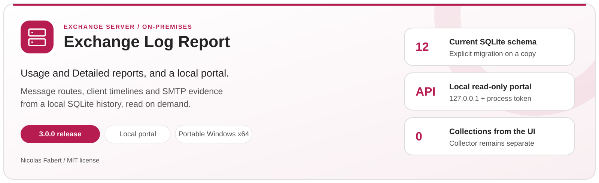
  </picture>
</p>

<p align="center">
  <a href="#get-started"><b>Get started</b></a> &nbsp;&middot;&nbsp;
  <a href="#how-it-works"><b>How it works</b></a> &nbsp;&middot;&nbsp;
  <a href="#noise-removed-before-storage"><b>Noise removed</b></a> &nbsp;&middot;&nbsp;
  <a href="#sessions-and-messages"><b>Sessions and messages</b></a> &nbsp;&middot;&nbsp;
  <a href="#reports"><b>Reports</b></a> &nbsp;&middot;&nbsp;
  <a href="package/docs/ExchangeLogReport-UserGuide.md"><b>User guide</b></a> &nbsp;&middot;&nbsp;
  <a href="package/docs/ExchangeLogReport-Guide.md"><b>Developer guide</b></a>
</p>

<p align="center">
  <a href="https://github.com/Nico77600/ExchangeLogReport/releases/latest"></a>
</p>

**Author:** Nicolas Fabert  
**Version:** 3.0.0

> [!TIP]
> **Download the latest release.** Open the [latest release](https://github.com/Nico77600/ExchangeLogReport/releases/latest) and download **`ExchangeLogReport-3.0.0-win-x64.zip`** under *Assets* (its SHA-256 is in the release notes). That ZIP is the whole signed tool: its own PowerShell, the portal, SQLite and the guides. Nothing else is installed. Do not use the **Source code** archives or the green **Code** button: they hold the scripts only, without the PowerShell runtime or the SQLite tools.

> [!IMPORTANT]
> Windows marks files downloaded from the Internet. After you extract the ZIP, check the publisher first (right-click a `.ps1`, for example `Invoke-ExchangeLogReport.ps1`, Properties, Digital Signatures: `Nicolas Fabert`), then unblock the extracted folder once:
>
> ```powershell
> Get-ChildItem "E:\Tools\ExchangeLogReport" -Recurse -File -Force | Unblock-File
> ```
>
> Replace the example path with the folder where you extracted the ZIP.

## Why

Exchange writes gigabytes of logs per day and per server, and almost none of it is user activity: Managed Availability probes, health mailboxes, load balancer checks, anonymous authentication challenges, SMTP connections without any message. Yet two questions come back all the time, and they used to need Log Parser queries on raw files, server by server. This tool answers both, for several servers at once.

<picture>
  <source media="(prefers-color-scheme: dark)" srcset="package/docs/images/readme-why-dark.png">
  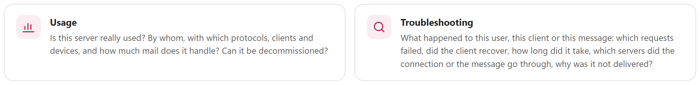
</picture>

## Get started

- Is this server still used, and by whom? → **Usage report** (A)
- Something failed for a user, a message or a server → **Detailed report** (B)
- Browse the collected history in your browser → **the portal** (C)

<picture>
  <source media="(prefers-color-scheme: dark)" srcset="package/docs/images/readme-path-dark.png">
  
</picture>

One path for everyone. Set the tool up once (**1 to 4**), then take one branch, or several:

- **A · Recurring reporting**: the **Usage report** made for you every month. For the messaging manager, the architects and operations: which servers can go, which old clients and applications remain, what keeps failing, without anyone running a command. The reports are HTML files, and can be sent by e-mail too.
- **B · Troubleshooting**: a **Detailed report** on a user, a message or an incident, answered in minutes. For the Exchange administrators and support.
- **C · Investigate in the browser**: the same history in **the portal** (Serve mode), read on demand without building a report first.

The commands use one example — servers `EXCH01` to `EXCH04`, the package extracted in `E:\Tools\ExchangeLogReport` on EXCH01 and run as SYSTEM, `contoso.com`, `alice`. Copy them as they are and only change these names to yours; the [user guide](package/docs/ExchangeLogReport-UserGuide.md) explains each step, what you should see and what to do if not.

| You want to | Run, from the package folder | You get |
|---|---|---|
| Set up once | `Run-Collector.cmd -Mode Discover`, then the hourly task of step 3 (its first run reads 14 days), then `Run-Collector.cmd -Mode Status` | the log folders of every server, the first 14 days of history, a status line per server |
| **A · Usage report** (which servers are really used) | `Run-Collector.cmd -Range Last30Days` (a report is the default mode, Usage the default type) | `reports\ExchangeLogs_Usage_<period>_<time>\ExchangeLogs.html` + CSV files |
| **B · Detailed report** (a user, a message, an incident) | `Run-Collector.cmd -ReportType Detailed -User alice@contoso.com -Start "2026-10-07 08:00" -End "2026-10-07 12:00"` | `ExchangeLogs.html`; above 200 MB of data, a small page **and** an `ExchangeLogs_data` folder next to it (keep them together, zip both to send them) |
| **C · The portal** (investigate in the browser) | `Start-Portal.cmd` | the portal opens in your browser on `http://127.0.0.1:<port>`, on the newest collected day; stop it with **Stop portal** or Ctrl+C |
| Measure or compact the database (rare) | `Database-Storage.cmd` (prints the three commands) | a JSON audit, or a **new** compacted or migrated copy; the original is never changed |

### Set up once · 1 to 4

```powershell
# On EXCH01, in Windows PowerShell (the blue icon) opened as administrator, in the folder
# of the package; the .cmd files start the PowerShell inside the package
cd E:\Tools\ExchangeLogReport

# 1 · List the servers: one @{ Name = 'EXCH01' } line per server, in Servers
notepad .\config\ExchangeLogReport.config.psd1

# 2 · Find the log folders, with your administrator account (not as SYSTEM)
.\Run-Collector.cmd -Mode Discover

# 3 · Collect every hour, as SYSTEM; the first run, now, reads 14 days of logs
schtasks /Create /F /RU SYSTEM /RL HIGHEST /TN "Exchange Log Report - collect" `
    /SC HOURLY /TR "E:\Tools\ExchangeLogReport\Run-Collector.cmd -Mode Collect"
schtasks /Run /TN "Exchange Log Report - collect"

# 4 · Check, once the first run is over: every server and every source has data
.\Run-Collector.cmd -Mode Status
```

Always start the tool through `Run-Collector.cmd`, by hand and in the scheduled tasks: it checks the package, then starts the PowerShell inside it with the right settings. Typed without argument, it shows the status.

### A · Recurring reporting · 5 to 7

**Usage report** — which servers are really used, by whom, with which clients.

```powershell
# 5 · Schedule the reports: every day at 07:00 the last 24 hours (Detailed),
#     the 1st of every month the last month (Usage); then a Usage report on the
#     last 30 days, now, so that you do not wait for the 1st
schtasks /Create /F /RU SYSTEM /RL HIGHEST /TN "Exchange Log Report - daily report" `
    /SC DAILY /ST 07:00 /TR "E:\Tools\ExchangeLogReport\Run-Collector.cmd -Range Last24Hours -ReportType Detailed"
schtasks /Create /F /RU SYSTEM /RL HIGHEST /TN "Exchange Log Report - monthly report" `
    /SC MONTHLY /D 1 /ST 07:00 /TR "E:\Tools\ExchangeLogReport\Run-Collector.cmd -Range PreviousMonth"
.\Run-Collector.cmd -Range Last30Days

# 6 · Open the newest report: an HTML file, it works offline and can be sent as is
Get-ChildItem .\reports -Recurse -Filter ExchangeLogs.html |
    Sort-Object LastWriteTime | Select-Object -Last 1 | Invoke-Item

# 7 · Option: by e-mail too. In the Mail section: SmtpServer = 'mail.contoso.com',
#     Port = 25, Encryption = 'StartTls', Authentication = 'Anonymous',
#     To = @('messaging-team@contoso.com'). Send a test message, then create
#     the two tasks of step 5 again with -SendMail at the end of /TR
notepad .\config\ExchangeLogReport.config.psd1
.\Run-Collector.cmd -Mode MailTest
```

<details>
<summary><b>What you get every month</b> · the usage of every server: EXCH04 used by nobody, EXCH03 by 7 users and a scanner only — the people to contact before it goes</summary>
<br>
<a href="package/docs/images/readme-report-overview.png?raw=true">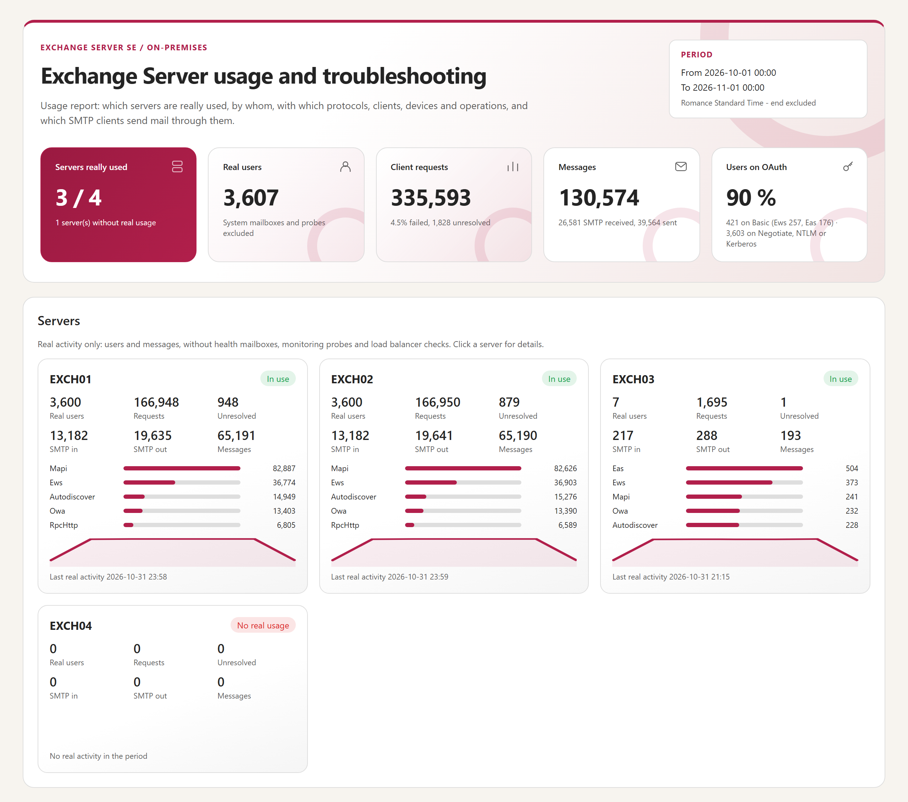</a>
</details>

<details>
<summary><b>With the e-mail option, every morning</b> · the main problems of the last 24 hours in the body, the report attached</summary>
<br>
<a href="package/docs/images/readme-mail-daily.png?raw=true">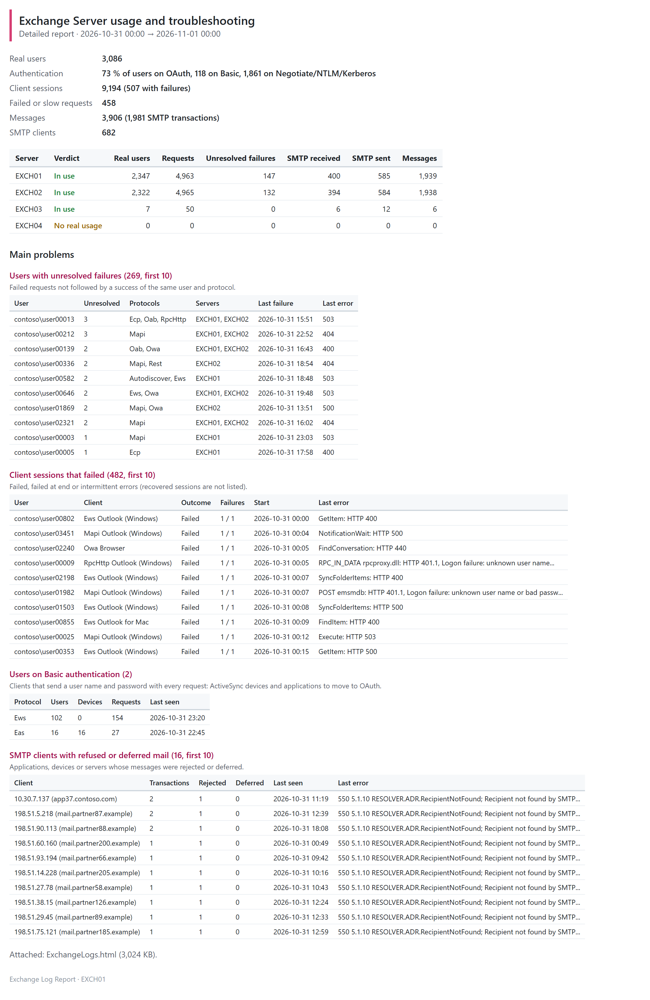</a>
</details>

### B · Troubleshooting · 5 to 7

**Detailed report** — a user, a message or an incident, with every client session, message and SMTP conversation of the period.

```powershell
# 5 · Alice says that Outlook and her phone kept failing this morning:
#     a Detailed report on her, on that period
.\Run-Collector.cmd -ReportType Detailed -User alice@contoso.com `
    -Start "2026-10-07 08:00" -End "2026-10-07 12:00"

# 6 · Open the HTML file shown at the end (reports\ExchangeLogs_Detailed_...\ExchangeLogs.html),
#     tab Client sessions, and click the session that failed
# 7 · Follow the timeline: each step shows what failed, front end and back end,
#     and the command that finds its raw log lines
```

<details>
<summary><b>What you see</b> · the timeline of the session, front end and back end; a step shows its fields and where its raw lines are</summary>
<br>
<a href="package/docs/images/readme-report-session.png?raw=true">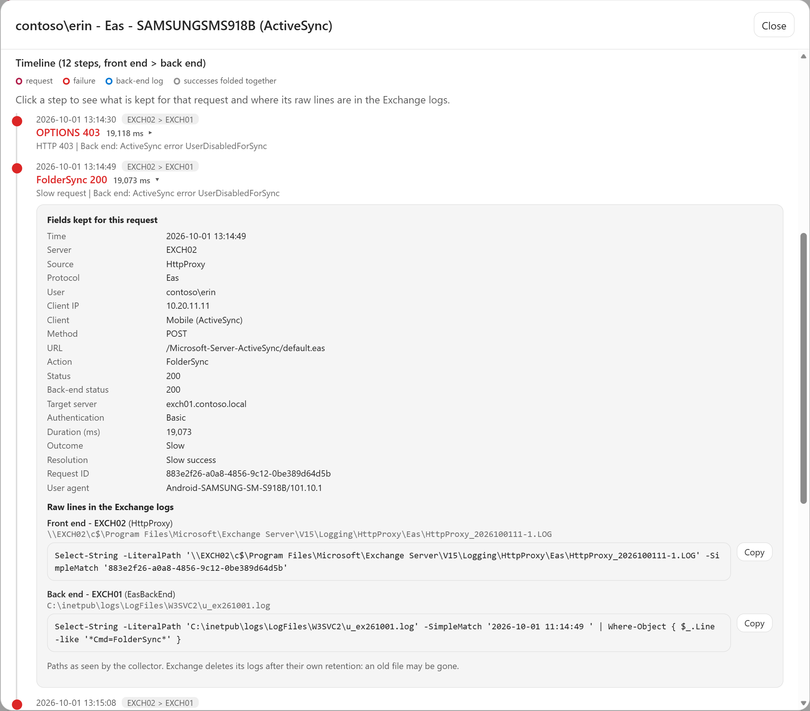</a>
</details>

A message that did not arrive (`-User bob@contoso.com`, tab **Messages**) or an incident on some servers (`-Server EXCH01,EXCH02`, tab **Failed and slow requests**) follow the same three steps: [user guide, chapter 5](package/docs/ExchangeLogReport-UserGuide.md#5-b--troubleshooting). The report is one `ExchangeLogs.html`; above 200 MB of data it is a small page plus an `ExchangeLogs_data` folder next to it — keep the two together, and zip both to send them.

### C · Investigate in the browser · 5 to 7

**The portal** — the **Detailed report page**, opened in your browser on the collected history, for the days you choose, without building a report first.

- It runs on this computer only (`127.0.0.1`), with a private link for each start.
- It never collects, never sends mail and never changes the database.
- **6** · Pick the days in the **day bar** under the tiles: **1 day**, **3 days**, **7 days**, **Previous day**, **Next day**, **Jump to day** (or **From** / **To**, then **Apply**). Then a tab: **Client sessions**, **Messages**, **SMTP clients**, **Authentication**... A pill tells where the rows are: **Loaded** (in the page) or **Remote** (more than 50,000 rows, read on the server). Filters and search cover the whole period either way.
- **7** · Click a row: its timeline, its route or its transcript. **Export view to CSV** writes the filtered list.

```powershell
# 5 · Start the portal on the collected history; it opens in your browser, on the newest day
.\Start-Portal.cmd

# Stop it with Stop portal, top right (or Ctrl+C in its window)
```

**What you see** · the page of the Detailed report on 7 days, zones ① to ⑥: ① the tiles (with **Users on OAuth**), ② the day bar with the rows of each day, ③ the servers, ④ the activity by day, ⑤ the tabs with their **Loaded** / **Remote** pills, ⑥ **Stop portal**

<picture>
  <source media="(prefers-color-scheme: dark)" srcset="package/docs/images/portal-overview-dark.png">
  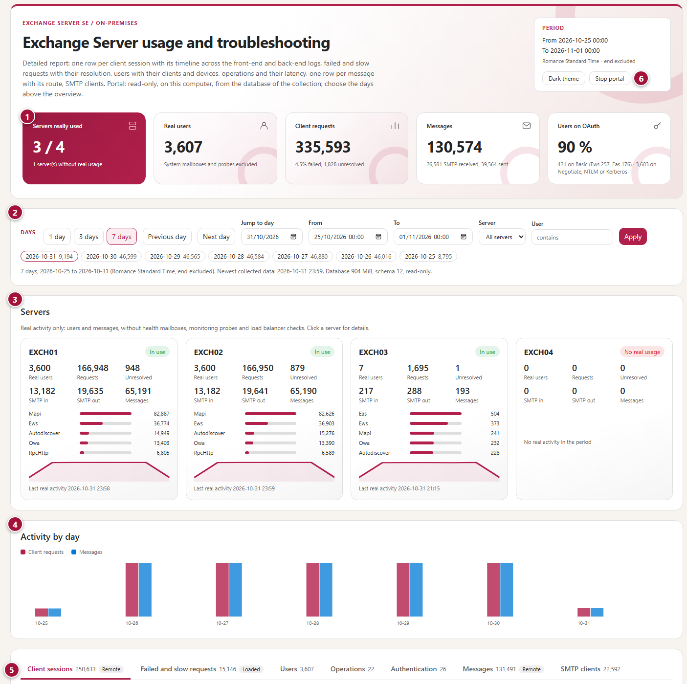
</picture>

<details>
<summary><b>A week of client sessions</b> · 250,633 rows, <b>Remote</b>: read on the server as you scroll; filters, search and export cover the whole week</summary>
<br>
<a href="package/docs/images/portal-sessions-remote.png?raw=true">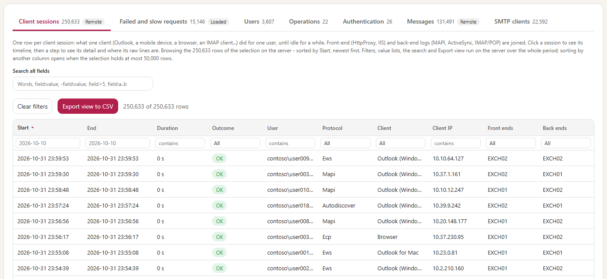</a>
</details>

<details>
<summary><b>A message, opened on demand</b> · its route: received, expanded to the members of a distribution list, delivered</summary>
<br>
<a href="package/docs/images/portal-message-route.png?raw=true">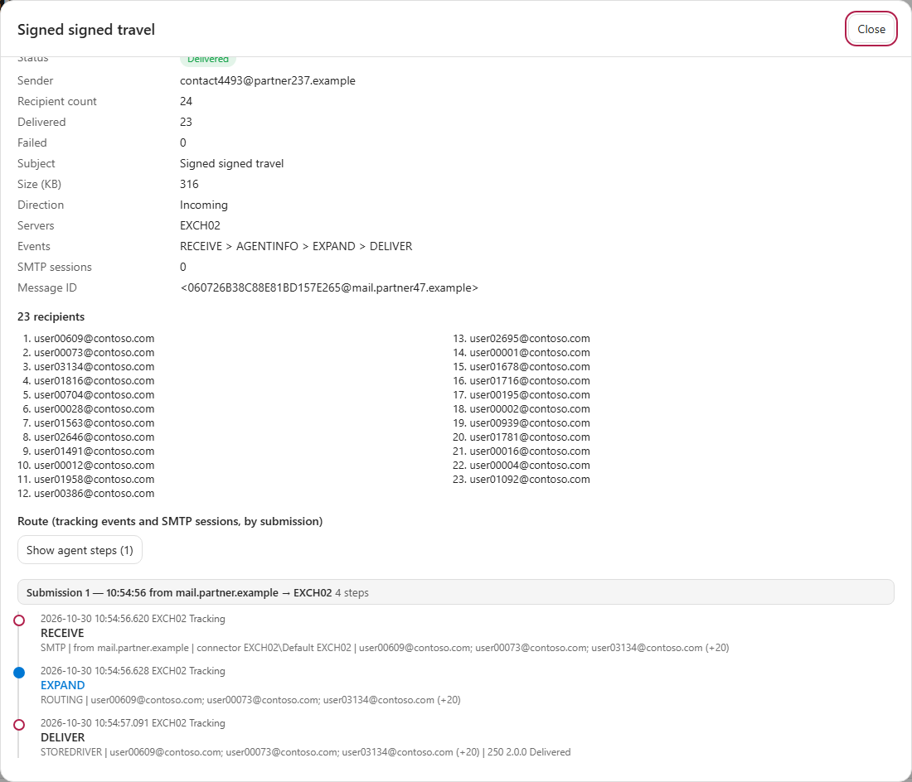</a>
</details>

**If it does not start or shows an error:**

- *The package could not be verified*: a file of the package was changed, blocked or replaced. Extract the release ZIP again, unblock it and start the launcher again.
- A database written by an older version is refused, never upgraded by the portal: run one collection with this version first ([upgrade from 2.1.1](CHANGELOG.md#upgrade-from-211-step-by-step)).
- Every other message, and what to do: [user guide, chapter 6](package/docs/ExchangeLogReport-UserGuide.md#6-c--investigate-in-the-browser).

**Use case · Check OAuth adoption (ActiveSync, EWS...)**

Which phones and applications still send a password (Basic) or use Windows authentication instead of OAuth? Three clicks, in the Usage report or in the portal:

1. Read the tile **Users on OAuth**: the share of users on OAuth, and how many still use Basic, with the two protocols that have the most (for example *Ews 257, Eas 176*).
2. Click the **Authentication** tab: one row per protocol and authentication type (**OAuth** in green, **Basic** in orange), with its users, clients and devices.
3. Click a row, for example **Eas** / **Basic**: the users and the devices behind it, with their last activity — the people to contact.

<details>
<summary><b>What you see</b> · the Authentication tab, then the row Eas / Basic opened</summary>
<br>
<a href="package/docs/images/portal-authentication.png?raw=true">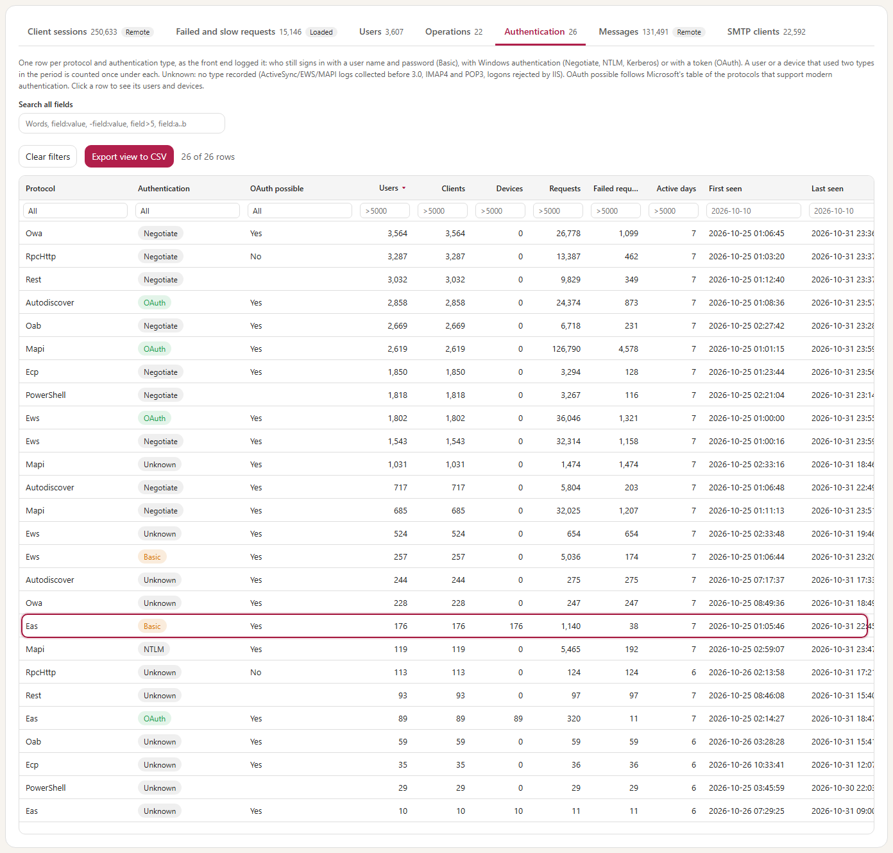</a>
<br><br>
<a href="package/docs/images/portal-authentication-row.png?raw=true">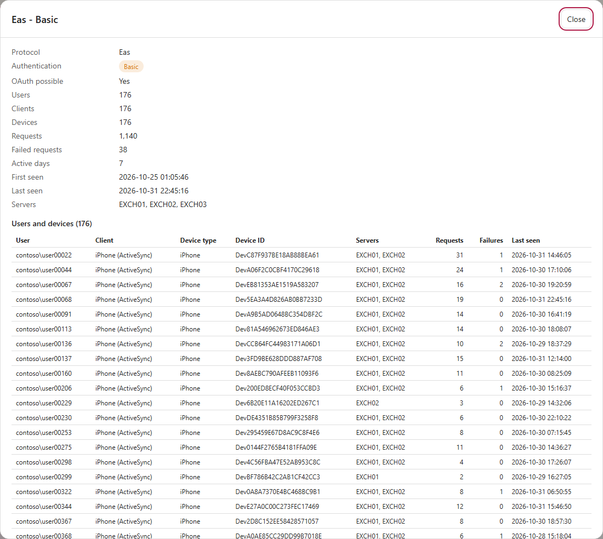</a>
</details>

More, including the *Unknown* rows and Outlook Anywhere: [user guide, chapter 4, step 6](package/docs/ExchangeLogReport-UserGuide.md#6--open-the-report).

Reports read the database: they take seconds to minutes, never wait for the collection, and read the new log lines first only when the last collection is older than 90 minutes. The database keeps 60 days of usage and 14 days of detail (client sessions, failed and slow requests, SMTP transcripts).

## How it works

<picture>
  <source media="(prefers-color-scheme: dark)" srcset="package/docs/images/readme-how-dark.png">
  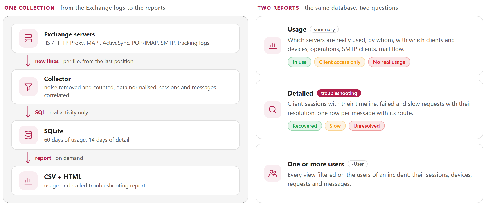
</picture>

- **Nothing to install on Exchange.** One collector — an Exchange server running the tool as SYSTEM, or an administration server — reads the log folders of every server over the administrative shares, every hour, and only the **new lines** of each file.
- **Fast, even on months of logs.** Every server and every source is read at the same time, and a single thread writes the database in large transactions. On the same lab collector and the same 14 days of logs of two servers (14.6 GB), 2.0.0 collects in **6 minutes** where 1.6 took **4 h 56 min**, and a 30-day usage report takes 2 min 30 s instead of 15 minutes. The hourly collection reads one hour of logs: a few seconds per server.
- **The real log folders, checked at every run.** `-Mode Discover` asks Exchange where each server really writes its logs — Exchange on another drive, SMTP logs moved per role, message tracking, POP/IMAP — and reads the IIS sites from `applicationHost.config`, including a second OWA/ECP site. It also reads the MAPI HTTP (`emsmdb` / `nspi`) and HttpProxy log folders moved in the applications' `web.config`; forced log paths still win. Every collection then follows a moved IIS log folder and warns when an expected folder is missing or a source has stopped writing.
- **One entry point, one configuration file.** `Invoke-ExchangeLogReport.ps1` (started by `Run-Collector.cmd`) finds the log folders (`-Mode Discover`), collects (`-Mode Collect`), builds a report from the database (`-Range`, `-Date`, `-Month`, `-Start` / `-End`, `-ReportType`, `-User`, `-Server`), sends it by e-mail (`-SendMail`, `-Mode MailTest`), shows what the database holds (`-Mode Status`) or serves it in the browser (`-Mode Serve`, started by `Start-Portal.cmd`). No parameter is ignored silently: a period that contradicts another is an error, and a parameter that the mode does not use is shown with the reason.
- **A local portal beside the reports.** The portal reads the same database, read-only, on `127.0.0.1` only, with a private link for each start. It loads only the page or the detail you ask for — client sessions, message routes, SMTP client groups and conversations — so a long period opens at once. Message hashes only accelerate lookups: the exact Message-ID text is always compared.
- **The portal reads only the days you choose.** It opens on the newest day; a list of more than 50,000 rows stays on the server and is read as you scroll, so a large database answers in seconds.
- **Edge Transport servers too.** Run on the Edge itself, the tool reads only its SMTP protocol logs and message tracking, and builds an **Edge report**: messages, SMTP clients (who sends to the Edge) and SMTP destinations (Exchange Online, internet MX, the mailbox servers).
- **Read-only** for Exchange: the tool only reads log files and settings (`Get-*` cmdlets, IIS configuration) and never changes a setting. The reports stay on the local disk, unless the `Mail` section sends them by e-mail: anonymous, Basic or Kerberos (GSSAPI) authentication, STARTTLS or TLS.

## Noise removed before storage

<picture>
  <source media="(prefers-color-scheme: dark)" srcset="package/docs/images/readme-noise-dark.png">
  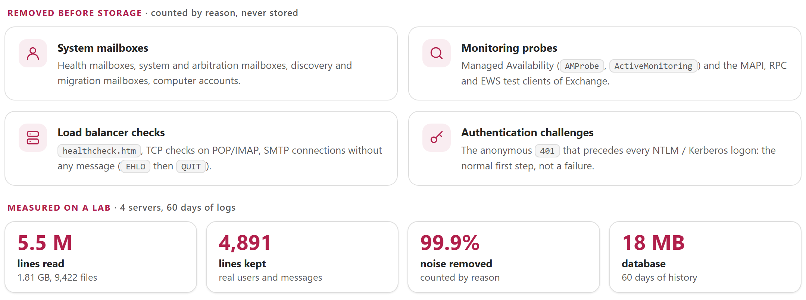
</picture>

> [!TIP]
> **A first failure is not a problem.** The anonymous `401` of the first Autodiscover or Outlook request is a normal authentication step, never counted as a failure. A real failure followed by a success of the same user is **Recovered**; only what stayed broken is **Unresolved**.

The 1–3 GB of logs per day and server of a production environment never reach the database as such: it grows with the number of real users and messages, not with the log volume.

## Sessions and messages

<picture>
  <source media="(prefers-color-scheme: dark)" srcset="package/docs/images/readme-sessions-dark.png">
  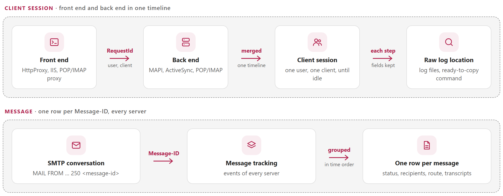
</picture>

- **One row per client session** — Outlook (MAPI), ActiveSync device, OWA, EWS, IMAP/POP client — with the result hidden behind HTTP 200 in the back end (MAPI status, `DeviceNotProvisioned`, `UserDisabledForSync`), the wrong passwords seen by IIS, slow requests, latencies, user agents and devices. Each step of the timeline shows the log files and a ready-to-copy command that finds the raw lines.
- **One row per message**, received or sent, with its status and its full route behind a click, plus the mail refused during the SMTP conversation. The route is in travel order, grouped by submission, with milliseconds; agent steps are folded. **SMTP clients** lists the applications, devices and servers that still send mail through the servers, with their authenticated user when Exchange logged one. The user comes only from a successful login that the server logged, at the time the message was accepted: a later login cannot replace an earlier transaction's user, and contradictory log lines withdraw it. Otherwise it shows *Not available*.

## Reports

Seven tabs — **Client sessions**, **Failed and slow requests**, **Users**, **Operations**, **Authentication**, **Messages**, **SMTP clients** — with search, filters, sortable columns and export, up to every row of every table. On an Edge Transport server, the report shows the mail flow only: **Messages**, **SMTP clients** and **SMTP destinations**. Every report also writes complete CSV files. Click a screenshot to open it at full size.

**Overview** · which servers are really used, by whom, with which protocols

<a href="package/docs/images/readme-report-overview.png?raw=true"></a>

**Client session** · the timeline across the front-end and back-end logs; a step shows the fields kept and where its raw lines are

<a href="package/docs/images/readme-report-session.png?raw=true"></a>

**Authentication** · which protocols and users are on OAuth, and who still uses Basic or Negotiate: one row per protocol and authentication type, its users and devices one click away, and the tile **Users on OAuth** on the overview

<details>
<summary><b>Message</b> · recipients, route across the servers and SMTP transcripts</summary>
<br>
<a href="package/docs/images/readme-report-message.png?raw=true">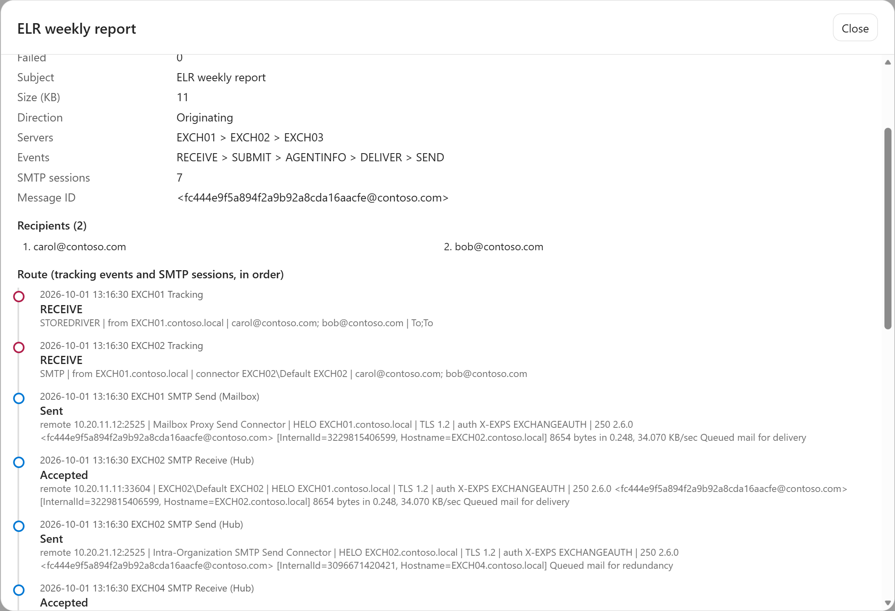</a>
</details>

<details>
<summary><b>SMTP client</b> · the applications and devices that send mail, each transaction with its SMTP transcript</summary>
<br>
<a href="package/docs/images/readme-report-smtp-client.png?raw=true">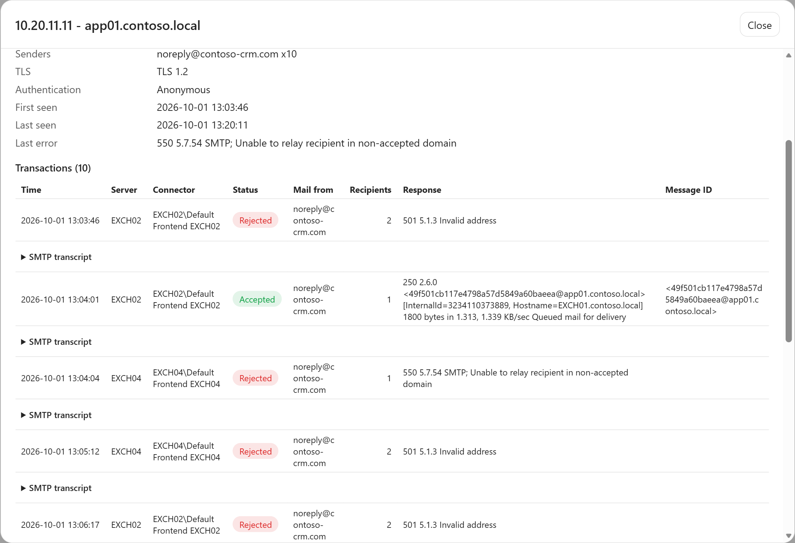</a>
</details>

<details>
<summary><b>Console</b> · title card, numbered steps, summary card with the report folder</summary>
<br>
<a href="package/docs/images/readme-console-report.png?raw=true">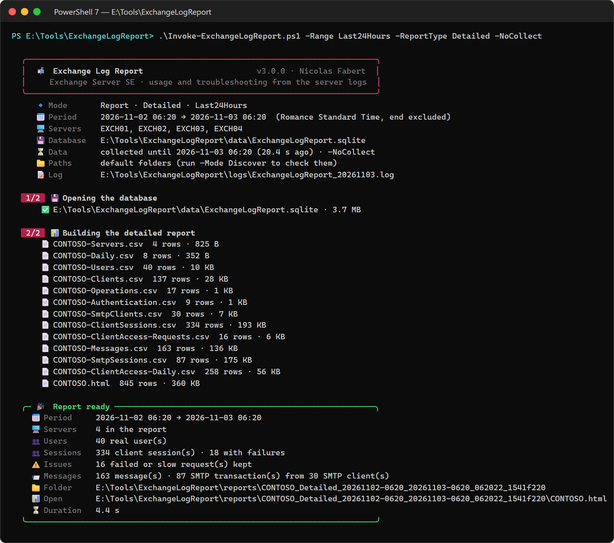</a>
</details>

**The portal** is the same page as the Detailed report, on the days you choose in its day bar: the same tiles and seven tabs, a row opens its timeline, its route or its transcript, and **Export view to CSV** writes the filtered list. A tab of more than 50,000 rows is **Remote**: read on the server as you scroll, with filters and search over the whole period.

<a href="package/docs/images/portal-server-selection.png?raw=true">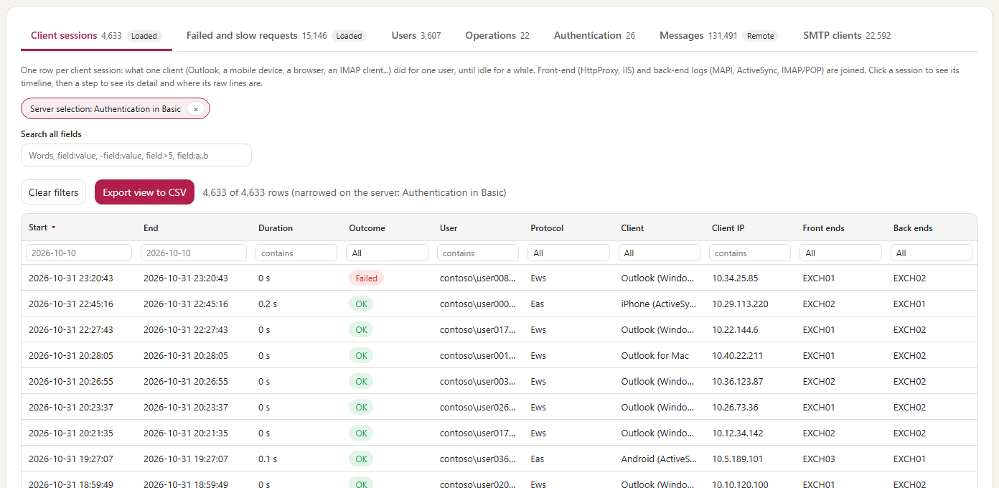</a>

**Message status** (Messages tab, Messages CSV, portal filter):

| Status | Meaning |
|---|---|
| Delivered | Every recipient received the message in a collected mailbox server. |
| Sent to external | Handed to a mail server outside your organization (the internet, a partner), which accepted it. What happens next is not in your logs. This is not a failure. |
| Delivered and sent to external | Some recipients received it here; a mail server outside your organization accepted it for the others. |
| Delivered and handed off | Some recipients received it here; the others were handed to a server whose logs are not collected (Exchange Online, an Edge, another Exchange server), or whose destination the logs do not prove to be outside your organization. |
| Handed off outside collection | Every recipient was handed to a server whose logs are not collected, or whose destination the logs do not prove to be outside your organization; the tool cannot see the end of the route. This is not a failure. |
| Suppressed (by design) | Exchange chose not to deliver it: out-of-office replies and automatic forwards that must not leave the organization, suppressed recipients, a distribution list that expanded to nobody. |
| Dropped | Removed by a rule, a transport agent or another drop; the route says which. |
| Failed, Deferred, Rejected | A delivery that failed, is waiting, or an SMTP conversation the server refused. |

After a recipient: `(Handed off)`, `(Sent to external)`, `(Suppressed)`, `(Expanded)` — a distribution list replaced by its members, not counted.

## Requirements

| Item | Requirement |
|---|---|
| Exchange | Exchange Server SE, on-premises |
| Portable package | Windows x64, nothing to install: PowerShell 7, the portal, SQLite and the storage tool are inside the ZIP. The collector scripts alone (the `package` folder of the repository) run on any PowerShell 7.4 or later, without the portal and the storage tool |
| `-Mode Discover` | Runs the Exchange cmdlets in Windows PowerShell 5.1 (built into Windows Server), since they are not supported in PowerShell 7 |
| Account | Local administrator of every Exchange server, to read the log folders over the administrative shares. On an Exchange server: SYSTEM (member of *Exchange Trusted Subsystem*), nothing to configure. On an administration server: a domain account, with *Log on as a batch job* on that server ([developer guide, 4.1](package/docs/ExchangeLogReport-Guide.md#41-where-to-run-it-and-with-which-account)) |
| Exchange role | *View-Only Organization Management*, for `-Mode Discover` only — the collection reads files and needs no Exchange role |
| Network | SMB (445) from the collector to every server; from an administration server, also HTTP (80) to one Exchange server for `-Mode Discover` (remote PowerShell, Kerberos) |
| Logging | SMTP protocol logging `Verbose` on the connectors to analyse; POP/IMAP protocol logs optional. HTTP Proxy, IIS, MAPI and message tracking logs are on by default |
| Browser | Any current desktop browser, for the HTML reports and the portal |
| Edge Transport | Its own copy of the tool on the Edge itself, as SYSTEM or a local administrator |
| E-mail (optional) | SMTP (25, 587 or 465) from the collector to a receive connector that accepts it: anonymous, Basic or Kerberos |
| SQLite | Bundled in `lib\sqlite` — nothing to install |

## Package layout

The ZIP has one top folder, `ExchangeLogReport-3.0.0-win-x64`:

```text
Run-Collector.cmd  Start-Portal.cmd  Database-Storage.cmd   launchers: verify the package, then start the bundled PowerShell
Invoke-ExchangeLogReport.ps1  Database-Storage.ps1  ExchangeLogReport.psm1  ExchangeLogReport.psd1   signed scripts
PackageIntegrity.psd1                      owner-signed list of every protected file and its SHA-256
config\ExchangeLogReport.config.psd1       the only file you edit (plus the generated paths and mail credential)
src\   lib\sqlite\   templates\   docs\    C# sources compiled in memory, SQLite, report template, HTML guides
powershell\   sqlite-tools\                PowerShell 7 runtime, SQLite command-line tool
data\  reports\  logs\                     created at run time
```

To move from an earlier version, see the [upgrade steps](CHANGELOG.md#upgrade-from-211-step-by-step).

## Documentation

The `package` folder of this repository holds the scripts and sources of the tool, with both guides; the ZIP of each [release](https://github.com/Nico77600/ExchangeLogReport/releases) is the complete package, with the HTML guides, the portal and the PowerShell runtime. `tools\Build-Standalone.ps1` builds that ZIP from the repository.

| Document | Content |
|---|---|
| **[User guide](package/docs/ExchangeLogReport-UserGuide.md)** | **The guided path**, step by step: set up once (**1 to 4**), then **A · Recurring reporting** (scheduled HTML reports, e-mail as an option), **B · Troubleshooting** (a user, a message, an incident) or **C · Investigate in the browser** (the portal). Each step gives the command to copy, what you should see and what to do if not; then how to keep it running, how to change the examples and the rare database maintenance. |
| **[Developer guide](package/docs/ExchangeLogReport-Guide.md)** | Everything else: the principles, where to run the tool and with which account, installation, configuration (servers and log folders found by `-Mode Discover`, sources, noise rules, slow-request threshold, retention), the scheduled collection and reports, the e-mail settings, how to read each tab of the report, the correlation rules, the data model, the portal, volumes and performance, troubleshooting, how to modify and validate the tool. |
| [CHANGELOG](CHANGELOG.md) | What changed, the upgrade steps from 2.1.1 and the validation of each version. |
| [SECURITY](SECURITY.md) · [PROVENANCE](PROVENANCE.md) | How to report a vulnerability · how the revision was reviewed and how the package is signed and attested. |

Both guides also exist as a single HTML file with a light and a dark theme (`package/docs/ExchangeLogReport-UserGuide.html`, `package/docs/ExchangeLogReport-Guide.html`): download them and open them locally, or use the copies in the release ZIP.

## Tests

```powershell
Invoke-Pester -Path .\tests\ExchangeLogReport.Tests.ps1   # Pester 6.1.0, logs generated in the exact Exchange formats, no Exchange server needed
```

The suites in `tests\` (collector, Serve, storage maintenance, package integrity, workflows) run one at a time; `.github\scripts\Invoke-CITests.ps1` runs them all under the freshly built package's own PowerShell, as the CI does. `tests\support\New-ExlSyntheticLogs.ps1` writes logs with the volumes of a production server (or a decommissioning case), and `tools\Measure-ExlCollection.ps1` measures a collection on them: the performance figures above come from these tools, on a PC and on the lab ([developer guide, chapter 12](package/docs/ExchangeLogReport-Guide.md#12-volumes-and-performance)).

The tool was also validated on a lab of four Exchange Server SE servers (two sites, one DAG) and an Edge Transport server with generated traffic: Outlook, iPhone and Android ActiveSync, OWA, EWS, Outlook for Mac, IMAP, POP, SMTP submission and relay, wrong passwords, blocked devices, internet mail through the Edge; and with a collector on an administration server, log folders moved to another drive and a second OWA/ECP web site (developer guide, chapter 14).

## Data handling

**The package is checked before it runs.** Every launcher checks the files of the package against a list signed by the author; a changed or unknown file stops the tool before anything runs. Your configuration is not checked: it is yours to edit. How the check works: [developer guide, 5.1](package/docs/ExchangeLogReport-Guide.md#51-package-integrity).

**The tool only reads Exchange.** It writes its database, reports and logs on the local disk of the collector. The portal runs on this computer only (`127.0.0.1`): never share its private link.

Report e-mail is disabled in the delivered configuration. `-SendMail` or `Mail.Enabled` enables it; `-SendMail:$false` suppresses it for one report. `-Mode MailTest` sends a test message independently of `Mail.Enabled`.

**What the reports contain.** Noise removal is not anonymisation. The database and reports can contain account names, e-mail and IP addresses, device identifiers, message subjects and SMTP transcripts.

**Who protects them.** You do: restrict access to the database and report folders, and review the recipients before enabling e-mail. The database deletes old data by itself, but not the HTML or CSV reports you exported or sent by e-mail: protect and delete those yourself.

Passwords and other sign-in data of SMTP conversations are removed before the database stores them. Transcripts stored by an earlier version are masked in reports and CSV exports; the existing database content is not rewritten.

## License

[MIT](LICENSE). The bundled SQLite components keep their own licenses: see [THIRD-PARTY-NOTICES.md](package/THIRD-PARTY-NOTICES.md).

## Disclaimer

This Script is a Personal project.
It's provided "AS-IS". It's not an official Microsoft product so no support can be expected from Microsoft.

As any scripts you must read carefully the documentation and test it first in a Test environment before any run in Production.
