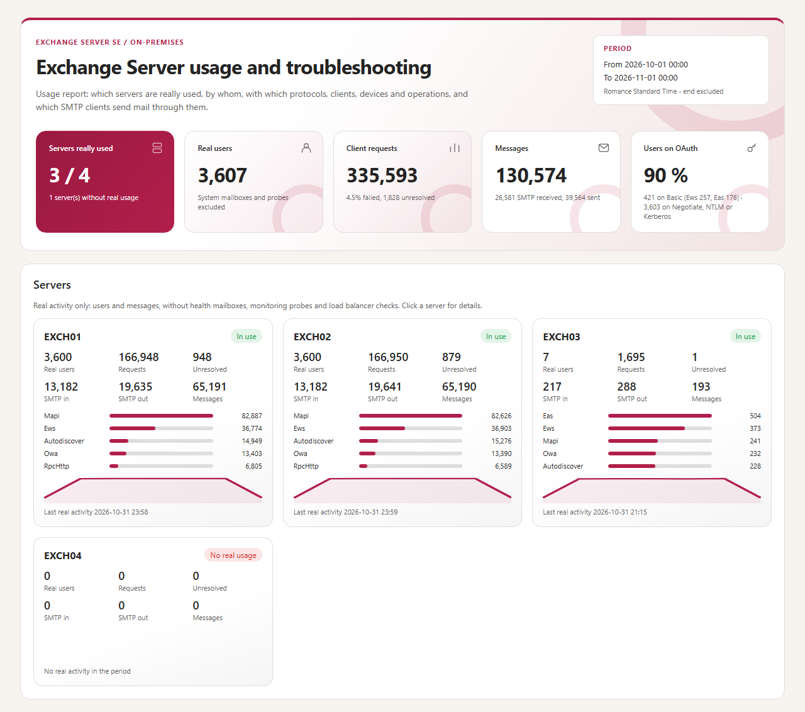
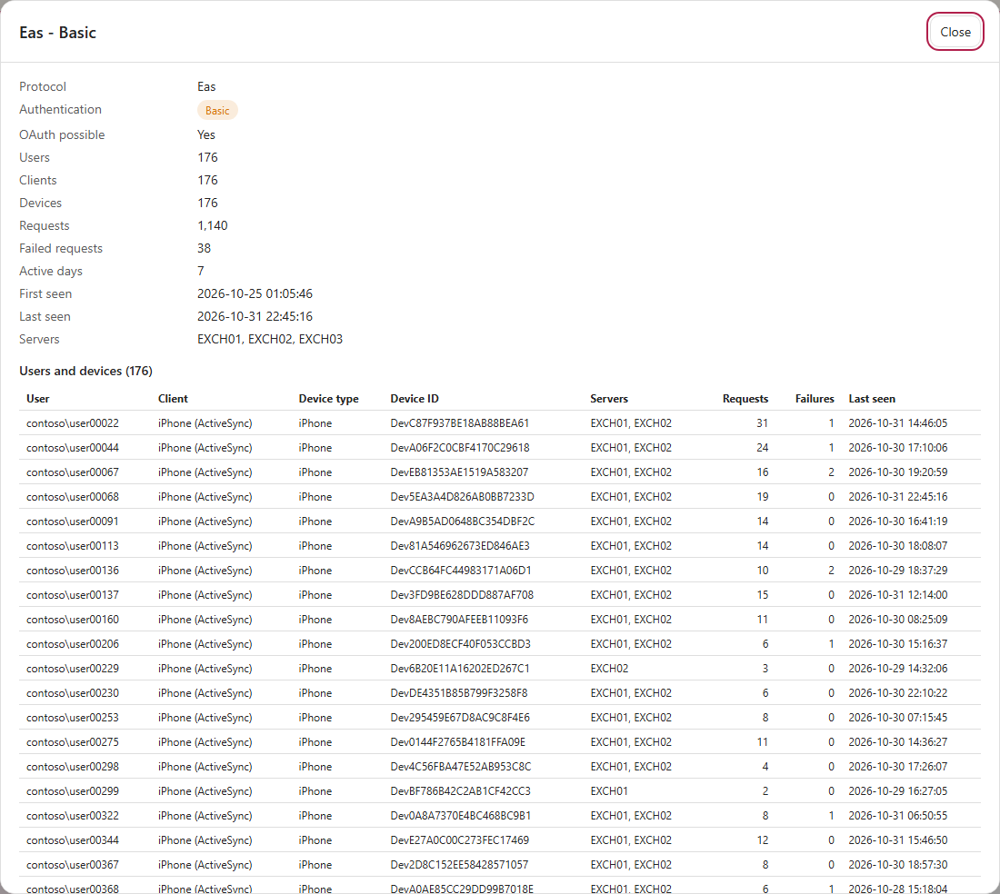
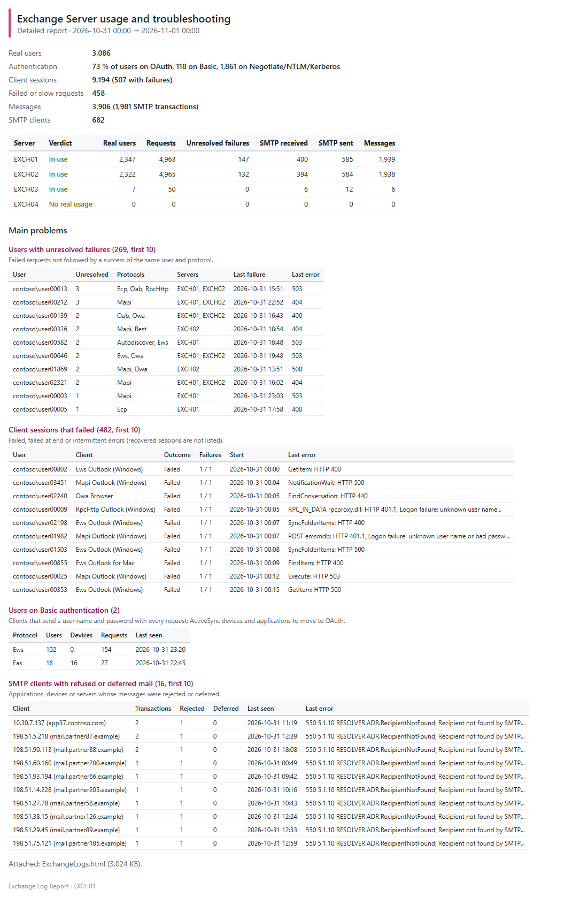
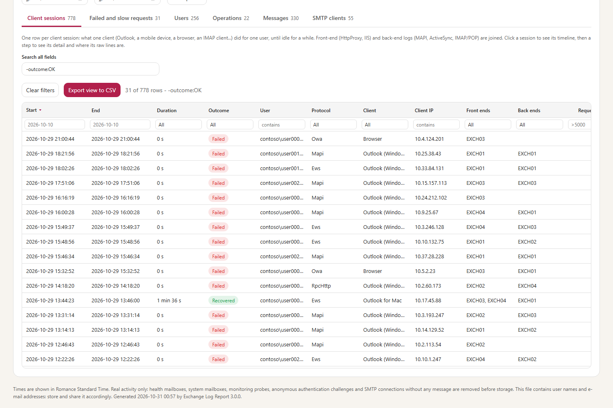
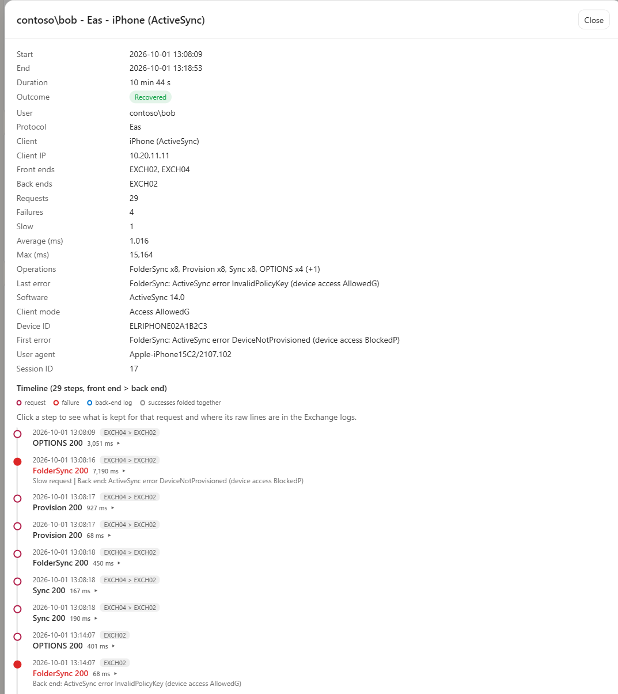
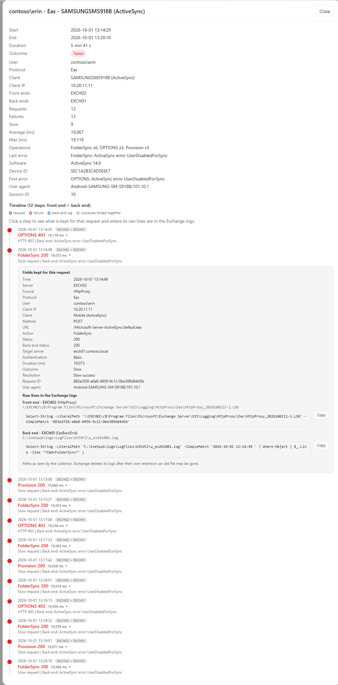
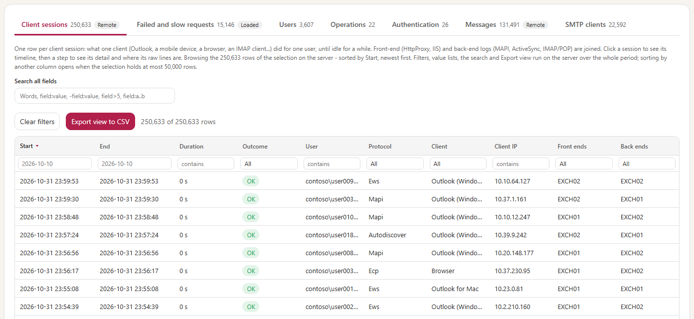
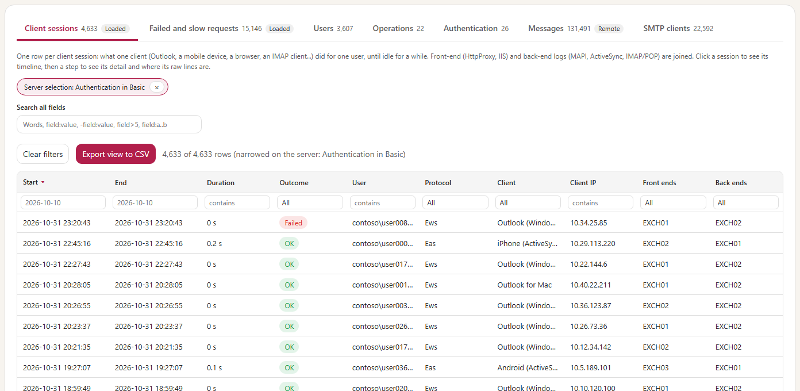
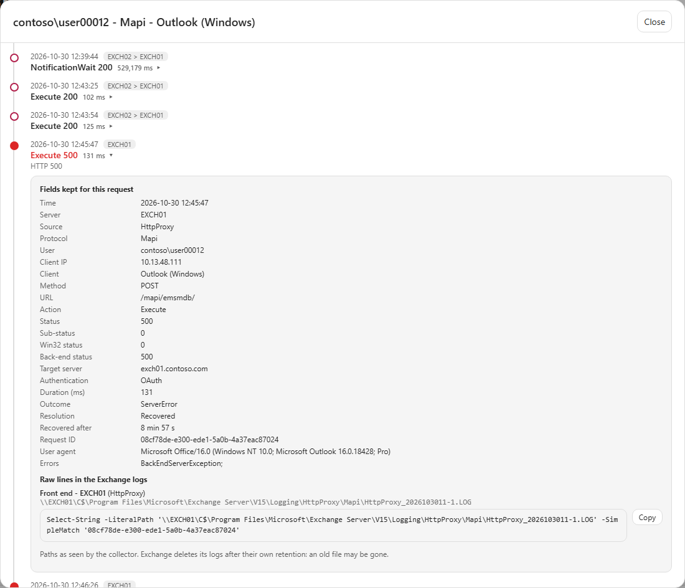
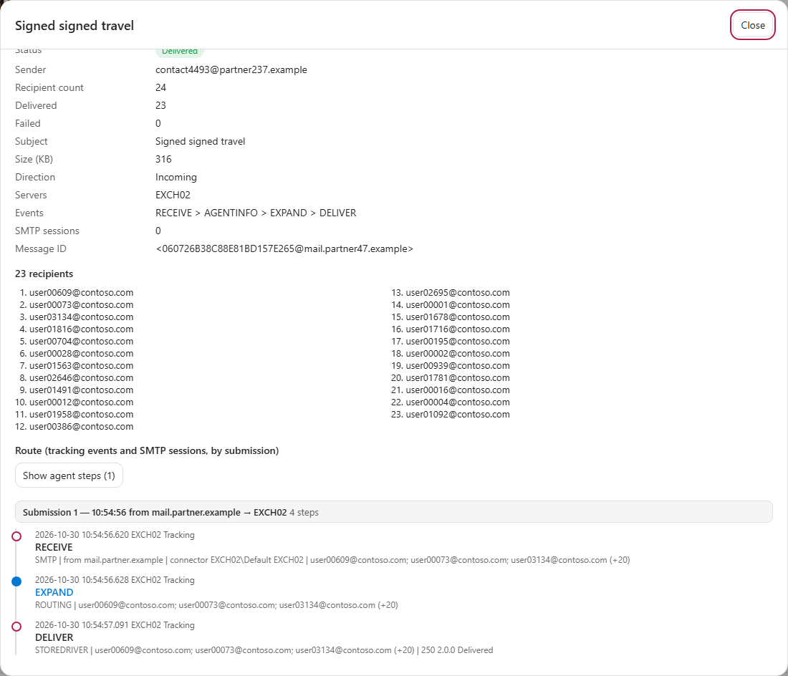

# Exchange Log Report — User guide

> Follow the path, one step after the other. Each step says **what to do**, gives the command to copy, says **what you should see**, and **what to do if not**. The line under each step says where it runs, with which account, and how long it takes. How the tool works, every setting and the internals are in the [developer guide](ExchangeLogReport-Guide.md).

**Words used in this guide**

| Word | What it means |
|---|---|
| Collection | Reading the new lines of the Exchange logs and saving what matters in the database. A scheduled task does it every hour. |
| Database | One file, `data\ExchangeLogReport.sqlite`, next to the tool. It keeps 60 days of usage and 14 days of detail. The reports and the portal read it. |
| Usage report | An HTML page: which servers are really used, by whom, with which clients and devices. |
| Detailed report | An HTML page for troubleshooting: every client session, failed request and message of a period. |
| Portal (Serve mode) | The Detailed report page in your browser, on this computer only, for the days you choose, without building a report first. |
| Day bar | The row of buttons under the tiles of the portal (above the servers) that chooses the days: **1 day**, **3 days**, **7 days**, **Previous day**, **Next day**, **Jump to day**. |
| Loaded / Remote | The pill next to a tab of the portal. **Loaded**: every row is in the page. **Remote**: more than 50,000 rows, read from the server as you scroll; filters and search still cover the whole period. |
| Scheduled task | A Windows task that starts the tool by itself: every hour for the collection, every day or month for the reports. |
| SYSTEM | The built-in Windows account the scheduled tasks run as. On an Exchange server, it can already read the logs of every Exchange server. |
| Collector | The computer where the tool runs and reads the logs of every server (EXCH01 in the example). |
| Source | One kind of log of one server: HttpProxy, IIS, MAPI, ActiveSync, SMTP receive or send, message tracking. |
| Front end / back end | The server that receives the request of the client, and the server that holds the mailbox. A request goes through both. |
| Authentication type | How a client proved who it is: a password with every request (Basic), Windows authentication (Negotiate), or a token (OAuth, the modern way). |
| SID | A security identifier such as `S-1-5-21-...`: how Exchange names an account on its OAuth requests. The tool pairs it with the account from the logs. |
| Launcher (`.cmd`) | `Run-Collector.cmd`, `Start-Portal.cmd` and `Database-Storage.cmd`: the files you run. Each one checks the package, then starts the tool. |

> [!IMPORTANT]
> Windows marks files downloaded from the Internet. After you extract the ZIP (chapter 2), check the publisher first (right-click a `.ps1`, for example `Invoke-ExchangeLogReport.ps1`, Properties, Digital Signatures: `Nicolas Fabert`), then unblock the extracted folder once:
>
> ```powershell
> Get-ChildItem "E:\Tools\ExchangeLogReport" -Recurse -File -Force | Unblock-File
> ```
>
> Replace the example path with the folder where you extracted the ZIP of the [latest release](https://github.com/Nico77600/ExchangeLogReport/releases/latest).

> [!WARNING]
> Noise removal is not anonymisation. Reports can contain account names, e-mail and IP addresses, device identifiers, message subjects and SMTP transcripts. Restrict access to the database and report folders. Database retention does not delete exported reports or copies sent by e-mail: protect and delete those separately.

> [!NOTE]
> Nothing is sent by e-mail unless you do step 7.

<!-- icon: flow -->
## 1. Start here

```path
Set up once | settings | Set up once: then the collection runs by itself every hour
Set up once | 1 | List the servers | write their names in the configuration
Set up once | 2 | Find the log folders | `-Mode Discover`, with your administrator account
Set up once | 3 | Collect every hour | a scheduled task; its first run reads 14 days of logs
Set up once | 4 | Check | `-Mode Status`: every server has data
A | chart | Recurring reporting
A | 5 | Schedule the reports | every morning the last 24 hours, every month the last month
A | 6 | Open the report | the HTML file in the reports folder
A | 7 | Option: by e-mail | the same reports, sent to your team
B | search | Troubleshooting on demand
B | 5 | Run a Detailed report | on the user and the hours of the problem
B | 6 | Open the client session | HTML report, **Client sessions** tab
B | 7 | Follow the timeline | each step: what failed, and where its raw log lines are
C | terminal | Investigate in the browser
C | 5 | Start the portal | `Start-Portal.cmd` opens it in your browser
C | 6 | Read one day | the newest day first; **Previous day** / **Next day**, 1, 3 or 7 days, **Jump to day**
C | 7 | Open a session, a message or an SMTP client | its timeline, its route or its transcript
```

1. Do steps **1 to 4** once. After that, the tool collects the logs by itself, every hour.
2. Then choose:
   - **A · Recurring reporting** — reports made for you every day and every month: which servers are really used, by whom, and what keeps failing. For the messaging manager, the architects and operations. You can also receive them by e-mail.
   - **B · Troubleshooting** — something went wrong for a user, a message or a server: you run one report and follow what happened. For the Exchange administrators and support.
   - **C · Investigate in the browser** — the same history, read on demand in the portal, without building a report first. For the Exchange administrators and support.
   - Or several of them.

**The commands use one example.** Copy them as they are, and only change the names in this table to yours:

| What | In the example | Change to |
|---|---|---|
| The Exchange servers | `EXCH01`, `EXCH02`, `EXCH03`, `EXCH04` | your servers |
| The server where the tool runs | `EXCH01` | one of your Exchange servers (or an administration server: chapter 2) |
| The folder of the tool | `E:\Tools\ExchangeLogReport` | where you extracted the ZIP |
| The domain, the users | `contoso.com`, `alice@contoso.com`, `bob@contoso.com` | your domain, your users |
| The day of a problem | `2026-10-07` | the day of your problem |

<!-- icon: checklist -->
## 2. Before you start

```steps
Download the package | Download `ExchangeLogReport-3.0.0-win-x64.zip` from the [latest release](https://github.com/Nico77600/ExchangeLogReport/releases/latest) (not the *Source code* archive). It carries its own PowerShell 7: nothing to install.
Extract it | Extract the ZIP into `E:\Tools\ExchangeLogReport` on EXCH01, then unblock that folder with the command of the box above. The folder holds `Run-Collector.cmd`, `Start-Portal.cmd` and `Database-Storage.cmd`.
Check your account | You can sign in to EXCH01 as an administrator, and your account is in the Exchange role group *View-Only Organization Management* (for step 2 only; ask the Exchange administrator, or run `Get-RoleGroupMember 'View-Only Organization Management'` in the Exchange Management Shell).
```

That is all for a tool that runs on an Exchange server: there, it runs as **SYSTEM**, which can already read the logs of every Exchange server.

### The details

| Item | Requirement |
|---|---|
| Exchange | Exchange Server SE, on-premises. Mailbox servers and Edge Transport servers. |
| PowerShell | **PowerShell 7 is inside the package** (`powershell\`). **Windows PowerShell 5.1** (built into Windows Server) for step 2 only. |
| Account | **Local administrator of every Exchange server** (the logs are read through `\\<server>\C$`). On an Exchange server: **SYSTEM**, nothing to configure. On an administration server: a **domain account** (not a local account), with *Log on as a batch job* on that server. |
| Exchange role | *View-Only Organization Management*, for step 2 only. The collection and the reports need no Exchange role. |
| Network | SMB (445) from the collector to every Exchange server. From an administration server, also HTTP (80) to one Exchange server for step 2. |
| Logging | SMTP: `ProtocolLoggingLevel Verbose` on the connectors to analyse (also what shows the authenticated user of SMTP clients). POP/IMAP: protocol log on (optional). HttpProxy, IIS, MAPI and message tracking are on by default. |
| Edge Transport | Its own copy of the tool **on the Edge itself** (chapter 8). |
| E-mail (option of step 7) | SMTP (25, 587 or 465) from the collector to a receive connector that accepts it. |

> [!WARNING]
> The account that collects is local administrator of the Exchange servers: treat it like an Exchange administrator account. The tool itself only reads: it never changes a setting, and sends nothing unless you turn on the e-mail of step 7.

On an administration server instead of an Exchange server: the commands to create the account, its group and its scheduled task are in the [developer guide, 4.1](ExchangeLogReport-Guide.md#41-where-to-run-it-and-with-which-account) and [chapter 7](ExchangeLogReport-Guide.md#7-scheduled-collection).

<!-- icon: settings -->
## 3. Set up once

On EXCH01, open **Windows PowerShell** (the blue icon in the Start menu; right-click, *Run as administrator*), then go to the folder of the tool. Keep this window open for all the steps. You do not need PowerShell 7 on the server: the `.cmd` files start the one inside the package.

Always use the launchers (`.\Run-Collector.cmd`, `.\Start-Portal.cmd`, `.\Database-Storage.cmd`), never the `.ps1` files directly. If a message names `Invoke-ExchangeLogReport.ps1`, type `.\Run-Collector.cmd` with the same parameters.

The launcher `Run-Collector.cmd` checks the package, then starts the PowerShell that is inside it:

```powershell
cd E:\Tools\ExchangeLogReport
```

### 1 · List the servers

*On EXCH01 · your administrator account · 2 minutes*

**Do:** open the configuration.

```powershell
notepad .\config\ExchangeLogReport.config.psd1
```

Press Ctrl+F and search `Servers = @(`. Replace the example lines by your servers, one `@{ Name = '…' }` line each (delete `EXCH02` if you do not have it), then save and close Notepad:

```powershell
Servers = @(
    @{ Name = 'EXCH01' }
    @{ Name = 'EXCH02' }
    @{ Name = 'EXCH03' }
    @{ Name = 'EXCH04' }
)
```

**You should see:** nothing yet. The names are enough: step 2 finds the rest.

### 2 · Find the log folders

*On EXCH01 · your own administrator account, not SYSTEM · a few minutes*

**Do:** run this in your window (your own administrator account; SYSTEM, the account of the scheduled task, has no Exchange role and cannot do this step).

```powershell
.\Run-Collector.cmd -Mode Discover
```

**You should see:** one line per server, then a green **Log paths discovered**.

**If not:** read the yellow lines.

- *Exchange remote PowerShell could not be opened*: run it on an Exchange server, or add `-ConnectTo EXCH01`.
- *Folder not readable*: your account is not administrator of that server.

### 3 · Collect every hour

*On EXCH01 · as SYSTEM, scheduled · first run about 6 minutes for two servers, then a few seconds every hour*

**Do:** copy the whole block. It creates the scheduled task, then starts its first run now:

```powershell
$run = 'E:\Tools\ExchangeLogReport\Run-Collector.cmd'

# Every hour: read the new log lines
schtasks /Create /F /RU SYSTEM /RL HIGHEST /TN "Exchange Log Report - collect" `
    /SC HOURLY /TR "$run -Mode Collect"

# The first run, now
schtasks /Run /TN "Exchange Log Report - collect"
```

**You should see:** `SUCCESS` twice (in the language of Windows).

**If not:** *Access is denied*: this PowerShell window is not run as administrator. Open PowerShell as administrator and copy the block again.

The first run reads the last 14 days of logs. It is the only long one: about **6 minutes** for two servers on the lab, more with many servers.

You see nothing in this window while it runs: the task works in the background as SYSTEM. Task Scheduler (`taskschd.msc`) shows it as *Running*, and the file of the day in `logs\` grows. Do not start the collection by hand in the meantime. A large first collection needs several GB of memory.

Then the task runs every hour and reads only the new lines: a few seconds. You never wait for it.

### 4 · Check

*On EXCH01 · your administrator account · 1 minute, a few minutes after step 3*

**Do:** a few minutes later, run:

```powershell
.\Run-Collector.cmd -Mode Status
```

**You should see:** one line per server and per kind of log, with its dates of data and the noise removed. Below them, a line *Sent to external: on* with the e-mail domains the tool learnt as yours (*not yet* until your servers have delivered some mail).

**If not:**

- *No database yet* / *Ready for the first collection*, or *No collection in the database yet*: the first run of step 3 is not over (or did not start). Wait a few minutes and run the command again. Still nothing after 15 minutes: open Task Scheduler (`taskschd.msc`), task *Exchange Log Report - collect*, and read its *Last run result* (chapter 8).
- A server without data: its logs are not readable (chapter 10).

**Done.** The tool is ready. Go to **A** (chapter 4), **B** (chapter 5), **C** (chapter 6), or several.

<!-- icon: chart -->
## 4. A · Recurring reporting

Two reports are made for you, in the folder `reports`:

- **every morning**, what happened in the last 24 hours;
- **the 1st of every month**, who used which server during the last month.

If you want, they can also arrive by e-mail (step 7).

### 5 · Schedule the reports

*On EXCH01 · your administrator account; the reports run as SYSTEM · 2 minutes*

**Do:** copy the whole block. It creates two scheduled tasks, then makes the daily report now, so that you do not wait until tomorrow:

```powershell
$run = 'E:\Tools\ExchangeLogReport\Run-Collector.cmd'

# Every day at 07:00: what happened in the last 24 hours (Detailed report)
schtasks /Create /F /RU SYSTEM /RL HIGHEST /TN "Exchange Log Report - daily report" `
    /SC DAILY /ST 07:00 /TR "$run -Range Last24Hours -ReportType Detailed"

# The 1st of every month at 07:00: who used which server last month (Usage report)
schtasks /Create /F /RU SYSTEM /RL HIGHEST /TN "Exchange Log Report - monthly report" `
    /SC MONTHLY /D 1 /ST 07:00 /TR "$run -Range PreviousMonth"

# The daily report, now
schtasks /Run /TN "Exchange Log Report - daily report"
```

**You should see:** `SUCCESS` three times (in the language of Windows).

**If not:** *Access is denied*: this PowerShell window is not run as administrator. Open PowerShell as administrator, go to the folder of the tool (chapter 3) and copy the block again.

### 6 · Open the report

*On EXCH01 · your administrator account · a few minutes*

**Do — 1. See the Usage report now**, without waiting for the 1st of the month: the last 30 days (the first time, as many days as the database holds).

```powershell
.\Run-Collector.cmd -Range Last30Days
```

**You should see:** a green **Report ready**, and the line **Open** with the path of the HTML file.

**Do — 2. Open it:** open the folder `reports`, then the newest folder (`ExchangeLogs_Usage_…`), and double-click `ExchangeLogs.html`. Or, in PowerShell:

```powershell
Get-ChildItem .\reports -Recurse -Filter ExchangeLogs.html |
    Sort-Object LastWriteTime | Select-Object -Last 1 | Invoke-Item
```

**You should see:** the report in your browser. It works offline, and you can send the file to anyone.

**If not:**

- *No collection in the database yet*: the first collection is not over (chapter 3, step 4).
- No new folder under `reports` for the daily report of step 5: the task did not run yet, or it failed.

1. Check its last result (`Get-ScheduledTaskInfo`, chapter 8: `0` is a success).
2. Read the red line in the log file of the day in `logs\`.

Each report is a new folder in `E:\Tools\ExchangeLogReport\reports`:

- the HTML file, and the same data in CSV files for Excel;
- for a very large report, also an `ExchangeLogs_data` folder next to the HTML file. Keep the two together, and extract a zipped report completely before opening it.

Delete the old folders when you no longer need them. Very large reports: memory, workers and temporary space are in the [developer guide, 6.4](ExchangeLogReport-Guide.md#64-collection-storage-report-logging).

**The Usage report** (the one you just made, and the monthly one) answers *is this server really used?* with one card per server. **The daily report** opens on the same cards for the last 24 hours, with the client sessions, the failed requests and the messages of the day: chapter 5 explains how to read them.



In this example:

- **EXCH04** says *No real usage*: in a whole month, only monitoring probes and load balancer checks reached it.
- **EXCH03** says *In use*, but by 7 users only:
  - Click the **Users** tab and choose EXCH03 in *Servers*: these 7 users, and their old clients — Outlook 2013, RPC over HTTP, an old Android, an EWS application, Internet Explorer.
  - Click the **SMTP clients** tab and choose EXCH03: a scanner still sends mail through it, without TLS.
  - The **Authenticated user** column shows the account that Exchange logged for a successful SMTP login. It is never guessed from the sender address: when no account is proven, it shows *Not available*.

These are the people to contact before EXCH03 goes. To look at that server only, for the last 30 days:

```powershell
.\Run-Collector.cmd -Range Last30Days -Server EXCH03
```

> [!TIP]
> **Who still uses a password or Windows authentication? (OAuth adoption)** Open the Usage report of step 6, then do the three clicks below. **OAuth** in green is the goal.

| Do | You should see |
|---|---|
| 1. Read the tile **Users on OAuth** | The share of users on OAuth, and how many still use Basic, with the two protocols that have the most (for example *Ews 257, Eas 176*). |
| 2. Click the **Authentication** tab (sorted by **Users**) | One row per protocol and authentication type: **OAuth** in green, **Basic** in orange. The rows answer the question for ActiveSync (`Eas`), EWS (`Ews`), Outlook (`Mapi`) and the other protocols. |
| 3. Click the row **Eas** / **Basic** (ActiveSync with a password) | The users and the devices behind that row, with their last activity: the phones and applications that still send a password with every request. These are the people to contact. |

**If not:**

- *Unknown* rows: no type in the log line. IMAP and POP have none; a logon that IIS refused (wrong password) has none either, so a row whose requests all failed is that case; and rows collected before version 3.0 have none (they stay until the retention removes them).
- *OAuth possible: No* on `RpcHttp`: Outlook Anywhere cannot use OAuth. Move those clients to MAPI over HTTP.
- A user shown as `s-1-5-21-...` with an orange **unresolved SID** pill: an account seen only with OAuth, that no password or OWA logon paired with its name yet. Click it: the **Identifiers** table shows its **Hints**, such as the account its device reported. If its status says *ambiguous*, two accounts claim it: check which one before naming it. Otherwise, put that pair in `config\ExchangeLogReport.identities.psd1` (`@{ 'S-1-5-21-...' = 'CONTOSO\erin' }`) and set `Collection.IdentityMapFile = '.\config\ExchangeLogReport.identities.psd1'`; the next collection merges it with the account.
- In the portal, the same answer is in the **Authentication** tab, and in the **Authentication** list of **Client sessions**.




### 7 · Option: receive the reports by e-mail

*On EXCH01 · your administrator account · 10 minutes*

> [!NOTE]
> Report e-mail is disabled in the delivered configuration. `-SendMail` or `Mail.Enabled` enables it; `-SendMail:$false` suppresses it for one report. `-Mode MailTest` sends a test message independently of `Mail.Enabled`. Review the recipients before using either feature.

**Do — 1. Say where to send them.** Open the configuration again:

```powershell
notepad .\config\ExchangeLogReport.config.psd1
```

Find the `Mail` section. Change these lines to your values, then save and close Notepad:

```powershell
Mail = @{
    Enabled        = $false                                 # keep $false: the tasks below say when to send
    SmtpServer     = 'mail.contoso.com'                     # your SMTP name, the one of its certificate
    Port           = 25
    Encryption     = 'StartTls'
    Authentication = 'Anonymous'
    From           = 'exchange-log-report@contoso.com'
    To             = @('messaging-team@contoso.com')
}
```

**Do — 2. Send a test message.**

```powershell
.\Run-Collector.cmd -Mode MailTest
```

**You should see:** a green **Test message sent**, and the message in the mailbox of messaging-team@contoso.com.

**If not:** the conversation with the SMTP server is shown, and the red line says why: name or certificate, port, account. See [Other e-mail settings](#other-e-mail-settings) below.

**Do — 3. Add the e-mail to the two reports.** The same commands as step 5, with `-SendMail` at the end (`/F` replaces the tasks):

```powershell
$run = 'E:\Tools\ExchangeLogReport\Run-Collector.cmd'

schtasks /Create /F /RU SYSTEM /RL HIGHEST /TN "Exchange Log Report - daily report" `
    /SC DAILY /ST 07:00 /TR "$run -Range Last24Hours -ReportType Detailed -SendMail"

schtasks /Create /F /RU SYSTEM /RL HIGHEST /TN "Exchange Log Report - monthly report" `
    /SC MONTHLY /D 1 /ST 07:00 /TR "$run -Range PreviousMonth -SendMail"
```

**You should see:** `SUCCESS` twice (in the language of Windows). The reports are still written in the `reports` folder; they are also sent.

The daily e-mail gives the figures (with an **Authentication** line: the share of users on OAuth) and lists the **main problems** in its body, so that it can be read without opening the report:

- users with unresolved failures;
- client sessions that failed;
- users on Basic authentication (one row per protocol): the devices and applications to move to OAuth;
- SMTP clients with refused mail.



### Other e-mail settings

| Authentication | When | In the `Mail` section |
|---|---|---|
| `Anonymous` | A receive connector that accepts the collector by its address (the example above, or a relay connector). | Nothing else. |
| `Basic` | An account and its password, sent only over TLS. | `Port = 587` and `CredentialScope = 'Computer'`, then save the account once from your window: `.\Run-Collector.cmd -Mode MailTest -Credential (Get-Credential 'CONTOSO\svc-elr-mail')`. With `'User'`, the file must be written by the account of the tasks, SYSTEM ([developer guide, 8.1](ExchangeLogReport-Guide.md#81-sending-the-report-by-e-mail)). |
| `Kerberos` | No password sent. On Exchange: port 587 (*Client Frontend*), with an account **that has a mailbox**: SYSTEM is refused (*Unable to proxy authenticated session*). | `Port = 587`, and save the account as for Basic. |

The saved account is protected by Windows: only this computer (with `CredentialScope = 'Computer'`), or only the account that saved it, can read it. A self-signed certificate: set `CertificateThumbprint`. Every value: [developer guide, 8.1](ExchangeLogReport-Guide.md#81-sending-the-report-by-e-mail).

<!-- icon: search -->
## 5. B · Troubleshooting

*Alice says: "This morning, Outlook and my phone kept failing."* Three steps, a few minutes.

### 5 · Run a Detailed report on the user and the hours

*On EXCH01 · your administrator account · a few seconds to a few minutes*

**Do:** copy the command. Change only the day, the hours and the user:

```powershell
.\Run-Collector.cmd -Start '2026-10-07 08:00' -End '2026-10-07 12:00' `
    -ReportType Detailed -User alice@contoso.com
```

**You should see:** at the end, a green **Report ready**, and the line **Open** with the path of the HTML file.

**If not:** *No collection in the database yet*: do steps 1 to 4 first.

### 6 · Open the client session

*In your browser · your account · 1 minute*

**Do:** select the path on the line **Open**, copy it (Enter), and paste it in the address bar of your browser. Or open the folder `reports`, the newest folder `ExchangeLogs_Detailed_…`, and double-click `ExchangeLogs.html`. Click the **Client sessions** tab, then the row of Alice whose **Outcome** column says *Failed*.

**You should see:** one row per Outlook, phone, OWA, EWS, IMAP or POP session of Alice, with its outcome: *OK*, *Recovered* (it failed, then worked again), *Intermittent errors*, *Failed*.



The report is in the folder `reports\ExchangeLogs_Detailed_<period>_<time>`, next to its CSV files.

Above 200 MB of data (`Report.SingleFileMaxMB`), the folder also holds `ExchangeLogs_data`. The page reads it: keep the two together, and zip the page and the folder to send them. A tab that is too big for the computer that opens it says so and offers **Load anyway**.

**If not:**

- *ExchangeLogs_data was not found next to this page*: copy the folder back next to the page and click **Try again**.
- *The report folder is too long* or *has less than 256 MB free*: fill in `Report.ScratchFolder` in the configuration with a local folder that has free space, and run the report again (`-HtmlLayout SingleFile` forces one file; it opens more slowly).

### 7 · Follow the timeline

*In your browser, then PowerShell on EXCH01 · your account · a few minutes*

**You should see:** the timeline of the session — every request, in order, from the front-end server (the one that receives the request) to the back-end server (the one that holds the mailbox):



The picture shows another case, Bob's iPhone, read the same way: some requests failed (red dots), and the outcome is *Recovered* because the last ones worked.

A red dot is a failure. Read its line: the HTTP status, and the real result hidden behind an HTTP 200 in the back end (MAPI status, `DeviceNotProvisioned`, `UserDisabledForSync`).

**Do:** click it. It shows everything kept for that request, and the command that finds its **raw lines** in the Exchange logs — click **Copy**, paste it in PowerShell:



### Other cases

Same three steps. Only the command of step 5 and the tab of step 6 change.

**Bob did not receive a message**

```powershell
.\Run-Collector.cmd -Range Last24Hours -ReportType Detailed -User bob@contoso.com
```

Tab **Messages**: each message with its status per recipient. Click it: its route through every server, and the SMTP conversations. Mail refused during the SMTP conversation (relay denied, unknown recipient) says *Rejected (SMTP)*.

| Status | Meaning |
|---|---|
| Delivered | Every recipient received the message in a collected mailbox server. |
| Sent to external | Handed to a mail server outside your organization (the internet, a partner), which accepted it. What happens next is not in your logs. This is not a failure. |
| Delivered and sent to external | Some recipients received it here; a mail server outside your organization accepted it for the others. |
| Delivered and handed off | Some recipients received it here; the others were handed to a server whose logs are not collected (Exchange Online, an Edge, another Exchange server), or whose destination the logs do not prove to be outside your organization. |
| Handed off outside collection | Every recipient was handed to a server whose logs are not collected, or whose destination the logs do not prove to be outside your organization; the tool cannot see the end of the route. This is not a failure. |
| Suppressed (by design) | Exchange chose not to deliver it: out-of-office replies and automatic forwards that must not leave the organization, suppressed recipients, a distribution list that expanded to nobody. |
| Dropped | Removed by a rule, a transport agent or another drop; the route says which. |
| Failed, Deferred, Rejected | A delivery that failed, is waiting, or an SMTP conversation the server refused. |

After a recipient: *(Handed off)*, *(Sent to external)*, *(Suppressed)*, *(Expanded)* — a distribution list replaced by its members, not counted.

The tool learns your own domains from the logs (the mail your servers deliver and send), with their sub-domains: `.\Run-Collector.cmd -Mode Status` lists them. A domain of yours that the logs have not shown yet, or a Send connector to a system inside your company (journaling, archiving, an internal relay), goes in `Collection.InternalDomains` or `Collection.InternalConnectors` of the configuration ([developer guide, 6.4](ExchangeLogReport-Guide.md#64-collection-storage-report-logging)); the next collection applies it. Mail to your own mailboxes in Exchange Online (hybrid) stays *Handed off*.

**Many users failed on EXCH01 and EXCH02 yesterday afternoon**

```powershell
.\Run-Collector.cmd -Start '2026-10-06 14:00' -End '2026-10-06 15:30' `
    -ReportType Detailed -Server EXCH01,EXCH02
```

Tab **Failed and slow requests**: all the users of one server failing at the same time is a server incident. *Recovered*: the same user worked again afterwards. *Unresolved*: the problem stayed.

**Alice and Bob, the whole day**

```powershell
.\Run-Collector.cmd -Date 2026-10-07 -ReportType Detailed -User alice,bob
```

Tab **Client sessions**, then tab **Messages**.

The details stay **14 days** in the database (client sessions, failed requests, SMTP conversations), the usage **60 days**: a Detailed report on an older day has less detail.

<!-- icon: terminal -->
## 6. C · Investigate in the browser

*You want to look at an incident without building a report first.* The portal is the **Detailed report page**, opened in your browser on the history already collected in the database, on this computer only. You choose the days; it reads them for you.

The Usage and Detailed reports stay available, separately: the portal is one more way to read the same history. It never collects, never sends mail and never changes the database.

| Stage | Who does it | Result |
|---|---|---|
| Discover, when needed | `Run-Collector.cmd -Mode Discover` with your Exchange rights | the configured log folders; the browser never discovers anything |
| Collect on the schedule of step 3 | `Run-Collector.cmd -Mode Collect` | the new log lines are saved in the database |
| Consult or export | the Usage and Detailed reports **or** the portal | files **or** the days you choose, and the details you open |

The portal in seven moves:

```steps
Open | `.\Start-Portal.cmd`: the page opens in your browser, on the newest day.
Pick the days | The **day bar** under the tiles: **1 day**, **3 days**, **7 days**, **Previous day**, **Next day**, **Jump to day**.
Read the tabs | The same tabs as the Detailed report. A pill says where the rows are: **Loaded** or **Remote**.
Filter and search | Type in a box under a column, or pick a value: the whole period is searched.
Open a row | A session, a message or an SMTP client: its timeline, its route or its transcript.
Export the view | **Export view to CSV**: every row of the list, with your filters.
Stop | **Stop portal**, or Ctrl+C in its window.
```

### 5 · Start the portal

*On EXCH01 · your administrator account · a few seconds; the window stays open while you use the portal*

**Do:** from the folder of the tool, run:

```powershell
.\Start-Portal.cmd
```

**You should see:** a console window that stays open, and the portal in your browser on `127.0.0.1`. It opens on the **newest day** of the collected data.

The launcher checks the files of the package before it starts. It does not collect logs, build a report or change the database.

The address in the browser holds a private access code, new at each start: never share or paste that address.

**If not:**

- *The package could not be verified. Read the message above.* (the window waits for a key): a file of the package was changed, blocked or replaced. Extract the release ZIP again, unblock it (box at the top) and start the launcher again.
- No history yet: do steps 1 to 4 first.
- A database written by an older version is refused: run one collection with this version, or prepare a **new** copy in the format of this version ([chapter 11](#11-database-maintenance-rare)). The portal never upgrades a database.

**To look at a copy of a database:** `.\Start-Portal.cmd -DatabasePath "D:\Review\ExchangeLogReport.sqlite"`. Make the copy while the collection is not running, or with `Database-Storage.cmd` (chapter 11): a `.sqlite` file copied while it is being written can be incomplete. `-DatabasePath` changes the portal only, not the scheduled collection.

### 6 · Pick the days, then read the tabs

*In the browser on EXCH01 · your account · a few seconds per day*

**Do — 1. Pick the days** in the **day bar**, just under the tiles:

| Click | What you get |
|---|---|
| **1 day**, **3 days**, **7 days** | That many days, ending with the day shown. |
| **Previous day**, **Next day** | The same number of days, one day earlier or later. |
| **Jump to day** | Pick a day in the calendar; the number of days stays the same. |
| **From**, **To**, then **Apply** | Any other period, up to 31 days. The start is included; the end is not. |
| **Server**, **User**, then **Apply** | Only one server, or only the users whose name contains your text. |
| A day button (`2026-10-30  46,599`) | The number is the rows of that day in the tab you are reading. On a **Loaded** tab the click reads that day alone; on a **Remote** tab the list scrolls to the first row of that day and the days stay. |

The line under the buttons repeats your choice: the days, the time zone (`Romance Standard Time` in the delivered configuration), the newest collected data, and the database (*read-only*).

**You should see:** the page below, zones ① to ⑥, for the days you chose. The tiles and cards are the ones of the Detailed report: real activity only, without probes and health mailboxes.

| Zone | What it is |
|---|---|
| ① Tiles | Servers really used, real users, client requests, messages, **Users on OAuth**. |
| ② Day bar | The days you read, one button per day with its rows, and the line that repeats your choice. |
| ③ Servers | One card per server: its verdict, users, requests and protocols. |
| ④ Activity by day | Client requests and messages, day by day. |
| ⑤ Tabs | The lists, with their number of rows and their pill **Loaded** or **Remote**. |
| ⑥ **Stop portal** | Ends the portal (top right, next to **Dark theme**). |


**Do — 2. Click a tab:** **Client sessions**, **Failed and slow requests**, **Users**, **Operations**, **Authentication**, **Messages** or **SMTP clients**. They are the tabs of the Detailed report (chapter 5), with the same columns. Next to the number of rows of a tab, a pill says where the rows are:

| Pill | Where the rows are | What works on the whole period |
|---|---|---|
| **Loaded** | In the page: every row of your days. | Everything: sort by any column, filters answer at once. |
| **Remote** | On the server, read as you scroll (more than 50,000 rows); every row can be reached. | Filters, value lists, the search and **Export view to CSV**. The list is sorted by its time only (click the head of that column for oldest first). |
| `12,000+` | The days are still being counted. | Wait a few seconds: the exact number follows. |



**Do — 3. Filter and search.** Type in the box under a column (`contains`), pick a value in a list (`All`), or type words in **Search all fields**. On a **Remote** tab, the server searches every day of your period:

- *Counting...*, then the result line: `107,188 of 250,633 rows - Protocol in Mapi`. The caption above the list then names both counts: `Browsing 107,188 of the 250,633 rows of the selection on the server`.
- A search that reads every row shows how far it is: `1,234 matches so far - searched 3 of 7 days (newest first)...`, with a **Stop** button. **Stop** keeps what was found (`Stopped: 1,234 matches so far - ...`).
- When your filter leaves 50,000 rows or fewer, they are loaded in the page: a chip **Server selection: ...** appears, and the pill says **Loaded** again. Click **×** on the chip to see every row again.



**Clear filters** removes the filters of the tab; the days stay.

**If not:** a message instead of the rows: find it in the table at the end of this chapter.

### 7 · Open a session, a message or an SMTP client

*In the browser on EXCH01 · your account · a few seconds per detail*

**Do — 1. A session.** In **Client sessions**, click a row. Read the **Timeline**, from the front end to the back end; click a step (a red dot is a failure) to see what was kept for that request and where its raw lines are. Click **Copy** and paste the command in PowerShell to find them. **Close** returns to the list.



**Do — 2. A message.** In **Messages**, click a row: its recipients, then its **Route** across the servers, in order. Read each step, not only the last status. To list the mail that left your organization, pick *Sent to external* or *Delivered and sent to external* in the list of values of the **Status** column.

**You should see:** those messages with a green status, and *(Sent to external)* after each recipient a mail server outside your organization accepted.



**Do — 3. An SMTP client.** In **SMTP clients**, click a row: its transactions; click one to read its SMTP transcript. The user shown comes from the accepted transaction: a later login on a long connection does not relabel an earlier one.

**Authentication:** the **Authentication** tab and the **Authentication** column of **Client sessions** (with its list of values: pick *Basic* or *OAuth*) show how each client signed in: see *Who still uses a password or Windows authentication?* in chapter 4, step 6. A user in an orange **unresolved SID** pill is an account Exchange logged by its SID that no log line names yet: the same box says what to do.

Details removed after the retention period, or from a source that is not collected, cannot be shown. An Edge Transport server has SMTP and tracking logs, without client sessions.

### Export the view and stop the portal

**Export view to CSV** writes the rows of the tab with your filters, not only the rows on the screen. On a **Remote** tab the server writes the file day by day; the download list of the browser shows its progress.


The lower panel of the picture is a summary drawn from the downloaded file: the portal does not show it. Open the file from the download list of the browser.

A file whose download stopped is not a complete export. CSV files, subjects, accounts and transcripts need their own access control and retention.

The portal does **not refresh itself**. After the next collection, press **F5** (or click **Apply**) to read the same days again, or **Next day** once a new day has data.

**Stop portal** (top right, or Ctrl+C in the console) ends the portal and its private address; the page then says *Portal stopped*. The scheduled collection is not affected. Closing the browser tab alone leaves the portal running.

### If you see a message

| If you see | What it means, and what to do |
|---|---|
| *No rows match the current filters.* | Nothing in these days with these filters. Check the days, the **Server** and **User** of the day bar, and the filters (**Clear filters**). The database keeps 14 days of detail (`Run-Collector.cmd -Mode Status`). |
| *Waiting for the server: other requests are in progress...* | The portal is busy with the other tabs. Wait: it goes on by itself. |
| *The request exceeded its deadline of 15 s. The pages it read are now cached: retry once, then narrow the period or the server.* (504) | The question was too big for the time allowed (15 s for a list or a detail, 60 s for the tiles and the users). The portal already tried once more. Click again: it is faster the second time. Still there: choose fewer days, one server or one user. |
| *The server is busy with other requests: try again in a moment.* (429) | The portal stayed busy too long. Wait a few seconds, then do the same click again. |
| *The export could not start: ...* | The reason follows, for example *16 exports are waiting to be downloaded: export the view again in a minute.* Wait, then click **Export view to CSV** again. |
| *More than 10,000 rows of this list share one second: narrow the selection with a filter to browse them.* | Too many rows at the same second. Add a filter (a user, a protocol). |
| *The rows of this part of the list could not be found again: reload the page.* | A collection changed the rows while you were reading. Press **F5**. |
| *... finish collection reconciliation first.* (503) | A collection is updating the database, or one was interrupted. Wait a few minutes (the hourly task finishes the work), then press **F5**. It is not an empty result. |

#### At start

| If you see | What it means, and what to do |
|---|---|
| *Access refused. Open the private launch address of the portal in this browser tab (Start-Portal opens it); never put its token in a ticket.* | Use the address that `Start-Portal.cmd` opened, in the same browser. If the portal was stopped, start it again. |
| *This database has schema ...; the portal reads schema 12 and never migrates a database.* | Run one collection with this version (it upgrades the database once), or prepare a new copy: `Database-Storage.cmd --storage-copy --migrate` ([chapter 11](#11-database-maintenance-rare)). |
| *Package integrity: ...* and *The package could not be verified* at start | A file of the package was changed, blocked or replaced. Extract the release ZIP again (do not edit files under the package except `config\`), unblock it (box at the top), and start the launcher again. |
| *HttpListener could not bind http://127.0.0.1:8765* at start | Another program uses that port on this computer. Start again on another port: `.\Start-Portal.cmd -Port 8766`. The launcher changes nothing in Windows (no firewall rule, no reservation). |

The console prints one line for each request stopped by its time limit, for example `Serve: 504 /api/overview/servers after 60,012 ms (deadline 60 s)`.

How the portal works inside: [developer guide, chapter 15](ExchangeLogReport-Guide.md#15-the-portal).

<!-- icon: lifebuoy -->
## 7. Common problems

The five messages seen most often, whatever you were doing:

| You see | Do this | Read more |
|---|---|---|
| *The package could not be verified. Read the message above.* | A file of the package was changed, blocked or replaced. Extract the release ZIP again, unblock it (box at the top), and start the launcher again. | [Chapter 6, step 5](#6-c--investigate-in-the-browser) |
| *No collection in the database yet* | The first collection has not run yet. Do step 3, wait a few minutes, then run `.\Run-Collector.cmd -Mode Status` (step 4). | [Chapter 3](#3-set-up-once) |
| *Access is denied* after `schtasks` | This PowerShell window is not run as administrator. Open PowerShell as administrator, go to the folder of the tool, and copy the block again. | [Chapter 3, step 3](#3-set-up-once) |
| *folder not found or not readable* | The account is not local administrator of that server, or the logs were moved. Run `.\Run-Collector.cmd -Mode Discover` again. | [Chapter 10](#10-results) |
| *The request exceeded its deadline of 15 s* (504, in the portal) | The question was too big for the time allowed; the portal already tried once more. Click again (it is faster the second time), or choose fewer days, one server or one user. | [Chapter 6](#6-c--investigate-in-the-browser) |

<!-- icon: refresh -->
## 8. Keep it running

### Is the collection working?

```powershell
# What the database contains, per server and source: dates of the data, last read, noise removed
.\Run-Collector.cmd -Mode Status

# Last result of the scheduled tasks: 0 = success, 2 = finished with warnings (or e-mail not sent), 1 = failure
Get-ScheduledTask -TaskName 'Exchange Log Report*' | Get-ScheduledTaskInfo | Select-Object TaskName, LastRunTime, LastTaskResult
```

`0xC000015B` (`3221225819`): the account of the task lacks *Log on as a batch job*. A source whose newest data is old has stopped writing, or its logs were moved: run step 2 again.

### The Data line of every report

A report reads the database. The **Data** line under its banner says how fresh the data is, and whether the report reads the new log lines first:

| Data line | What happens |
|---|---|
| `collected until 16:45 (20 min ago)` | The hourly collection runs normally: the report reads the database. |
| `… the period is complete` | The period ends before the last collection (`PreviousMonth`, a past incident): the report reads the database, whatever the age of the data. |
| `… more than 90 min …: the new log lines are read first` | The last collection is older than 90 minutes (`Report.MaxDataAgeMinutes`): the report first reads the lines written since. **Check the task of step 3.** |
| `… a collection is running …` | The report does not wait: it uses the data already collected. |
| `No collection in the database yet` (error) | Step 3 has not run yet. A report never starts the first collection on its own. |

Add `-Collect` to read the new lines first whatever the age of the data, `-NoCollect` to never read them. `-NoCollect` means *read no log*, not *change nothing*: after you update the tool, the first report changes the database once (next section).

### After you update the tool

*On the server where the tool runs · your administrator account · a few minutes*

**Do:** after you replace the files of the tool with a new version, run:

```powershell
.\Run-Collector.cmd -Mode Status
```

**You should see:** the usual table. The first command after an update (this one, a report, even with `-NoCollect`, or the hourly collection) brings the database to the format of the new version, once. On a very large database this can take several minutes: try it first on a copy ([chapter 11, step 3](#11-database-maintenance-rare)).

**If not:** *The database must be upgraded once for this version before it can be read, and a collection is running*: the hourly collection is working. The command waited 2 minutes for it. Run the command again when the collection has finished (a few minutes later).

### Time zone error

The configuration file sets `Report.TimeZone = 'Romance Standard Time'` (Paris, with summer time). Another zone: a Windows name such as `'W. Europe Standard Time'` (`Get-TimeZone -ListAvailable` lists them). If a command stops with **Unknown time zone**, correct that line and run the command again.

### After an Exchange update (CU), a new server or a moved log folder

Add a new server to the `Servers` block (step 1), then run step 2 again with your administrator account and read its warnings:

```powershell
.\Run-Collector.cmd -Mode Discover
```

**If the protocol logs were moved in `web.config`:** the tool detects customized MAPI HTTP and HttpProxy folders too, including separate MAPI mailbox and address-book folders. It checks them again at every collection. A warning says which setting could not be read; a path you forced in the tool configuration remains the priority. A report with `-NoCollect` never reads these files.

### Edge Transport server

On the Edge itself, its own copy of the tool and the same steps 1 to 4, run as a local administrator or SYSTEM (on an Edge, step 2 accepts both). The report is an **Edge report**: messages through the Edge, **SMTP clients** (who sends to the Edge) and **SMTP destinations** (Exchange Online, the MX of the internet domains, the mailbox servers).

```powershell
.\Run-Collector.cmd -Range Last7Days -ReportType Detailed
```

<!-- icon: calendar -->
## 9. Change the examples

The commands above fix one example. Everything in them can be changed:

| To change | Write | Example |
|---|---|---|
| The period | `-Range Last24Hours`, `Last7Days`, `Last30Days`, `PreviousMonth` | `-Range Last30Days` |
| | `-Date` one day | `-Date 2026-10-04` |
| | `-Month` one month | `-Month 2026-09` |
| | `-Start` / `-End`: start included, end excluded; an end later than now is replaced by now | `-Start '2026-10-05 08:00' -End '2026-10-05 12:00'` |
| The type | `-ReportType Usage` (who uses which server) or `Detailed` (+ client sessions, failed and slow requests, messages) | `-ReportType Detailed` |
| The users | `-User`: any part of the account (`domain\sam`), sign-in name (`user@domain`) or e-mail address; several separated by commas, no space after the comma | `-User alice,bob@contoso.com` |
| The servers | `-Server`: one or more servers of the configuration | `-Server EXCH01,EXCH02` |
| The freshness | `-Collect` (read the new log lines first) or `-NoCollect` (never; after an update, the database is still upgraded once, chapter 8) | `-Collect` |
| The folder of the report | `-OutputPath` | `-OutputPath D:\Reports` |
| The e-mail | `-SendMail` (send this report), `-SendMail:$false` (do not) | `-SendMail` |

> [!NOTE]
> **No parameter is ignored silently.**
> - `-Date`, `-Month` and `-Start` / `-End` select their period on their own: `-Range` is not needed.
> - `-Start` needs `-End`, and `-Date`, `-Month` and `-Start` / `-End` cannot be combined.
> - A period that contradicts `-Range` (`-Range Last7Days -Start …`) is an error: nothing runs.
> - A parameter that the mode does not use (a period with `-Mode Collect` or `-Mode Status`, for example) is shown in yellow under the banner, with the reason, and the command runs anyway.

<!-- icon: file -->
## 10. Results

Each report is written to a new folder under `reports\`, one per run, named after the report type, the period and the time (`ExchangeLogs_Detailed_…`). The console shows it at the end:

- **`<prefix>.html`** — the report: self-contained, it can be sent by mail or opened without internet access. Search, filters, sortable columns, *Export view to CSV*; click a row for its details.
- **`<prefix>-<view>.csv`** — the same data (Servers, Users, Messages...), always complete: separator `;`. A double-click opens it in Excel on a Windows whose list separator is `;` (French settings); otherwise use *Data*, *From Text/CSV*. **`<prefix>-Authentication.csv`** lists each protocol and authentication type with its users and devices.

| Exit code | Meaning |
|---|---|
| `0` | Success. |
| `2` | Finished with warnings: a server, a folder or a file could not be read, a source is stale, the IIS or application log folders changed since `-Mode Discover`, or the report could not be sent by e-mail (or a recipient was refused). The run went to the end: a report run still writes its report. |
| `1` | Failure: read the error in red, and the log file of the day in `logs\`. |

| Warning | What to do |
|---|---|
| *folder not found or not readable* | The account is not local administrator of that server, or the logs were moved: run `-Mode Discover`. |
| *Application logs of '…' moved to …* | The collection already follows the new protocol log folder. Run `-Mode Discover` to record it. |
| *log settings could not be read* | Check the `web.config` or external XML file named in the warning and its permissions. The paths already known are kept; the data of that server can be incomplete until the file is readable. |
| *SMTP protocol logging is off on …* (`-Mode Discover`) | That SMTP traffic is not in the reports: set `ProtocolLoggingLevel Verbose` on the connector if it matters. |
| *No log line newer than 24 h for …* / *Logging stopped, or the logs were moved* | The collection or the logging stopped, or the old folder is read: check the scheduled task, then run `-Mode Discover`. |
| *The paths file was written on …* | The tool folder was copied from another computer: run `-Mode Discover` on this one. |
| *No collection in the database yet* | Run `-Mode Collect` once (it reads the last 14 days), then schedule it every hour (step 3). |
| *… more than 90 min (Report.MaxDataAgeMinutes) …* at every report | The hourly collection is not running: check the scheduled task (chapter 8). |
| *The report was not sent by e-mail* | The reason follows (server not reachable, certificate not trusted, account refused, STARTTLS not offered). Run `-Mode MailTest` with the account of the task: it shows the SMTP conversation. |

Anything else: [developer guide, Annex A — Troubleshooting](ExchangeLogReport-Guide.md#annex-a--troubleshooting).

<!-- icon: wrench -->
## 11. Database maintenance (rare)

You need this chapter in two cases only: you want a **copy** of an older database in the format of this version without upgrading the original (one collection with this version upgrades the original itself), or you want to know what takes space in the database before deciding anything (a read-only audit). Daily use never needs it.

`Database-Storage.cmd` runs the storage commands in the PowerShell of the package. It starts in a few seconds (the engine and the storage sources are compiled in memory at each start), then works on files that you name. **The original database is never changed or replaced**: every copy is a new file, and every command refuses a destination or an output file that already exists. Without argument it prints the three usual commands.

Before you start:

- Run it between two collections: disable the task *Exchange Log Report - collect* (Task Scheduler, right-click, *Disable*), and enable it again at the end.
- Work on a local disk (`D:\Review` in the examples), never on a network folder or a shortcut, with a short folder path.
- A database that is being written has a second file next to it (`…sqlite-wal`): copy it with `--storage-copy` below, not with a plain file copy, which can miss the last writes.
- Free space: keep three times the size of the database free on that disk. Files named `etilqs_*` left there after a crash are temporary files: delete them.
- Nothing here changes the original database: every command writes a new file and refuses to overwrite one.
### 1 · Measure first (read-only)

```powershell
.\Database-Storage.cmd --storage-audit --database "D:\Review\Source.sqlite"
```

**You should see:** a text report (`.json`) on the screen, with the size of every table, the space really used and the space wasted, and a list of recommendations. With `--output "D:\Review\Source.audit.json"` it is also saved in a file that you keep. Nothing is written to the database.

### 2 · Compact a new copy

```powershell
.\Database-Storage.cmd --storage-copy --database "D:\Review\Source.sqlite" --destination "D:\Review\Compacted.sqlite" --output "D:\Review\Compacted.audit.json" --confirm-copy --vacuum
```

This compacts the copy and keeps its format. No saving is promised. A database that a collection is writing is refused.

**You should see:** a text report (`.json`) that starts with `"success": true` and `"sourceUnchanged": true`; the new file `Compacted.sqlite` and its audit `Compacted.audit.json` are next to the source. If a check fails, the report says `"success": false` with the reason, and nothing is left at the destination.

### 3 · Prepare a copy for this version

```powershell
.\Database-Storage.cmd --storage-copy --database "D:\Review\Source.sqlite" --destination "D:\Review\Optimized.sqlite" --output "D:\Review\Optimized.audit.json" --confirm-copy --migrate --repack --vacuum
```

`--migrate` brings the copy to the format of this version, and `--repack` compresses the long texts. The command checks the contents of the copy before it saves the destination, and writes the before and after audits in the `--output` file. Keep the source and the audits. Never point 2.x at a database prepared by this version.

**You should see:** the same kind of report as step 2, with `"success": true`; the new file `Optimized.sqlite` and its audit `Optimized.audit.json` are next to the source.

**If a command refuses:** the message names the rule:

- a destination or an output file that already exists;
- a folder that is not a normal local folder;
- a database that a collection is writing;
- a database too old or too new for this version;
- a check of the copy that did not match (nothing is left at the destination).
